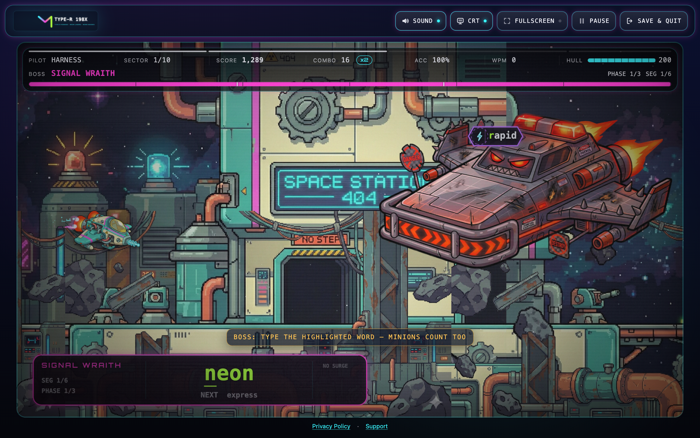

# Type-R 198X



Type-R 198X is a neon arcade typing shoot-'em-up by **Christopher Bradford**. Type the first letter of a
target to lock on, finish the word to fire, and clear ten sectors of word-bosses. It is a static web app
(plain HTML, CSS and classic JavaScript, no bundler, no runtime dependencies) that plays at
**[https://typer198x.com](https://typer198x.com)** and can be served from any static host.

This README describes the web build after the 2026 overhaul. Release steps live in [DEPLOY.md](./DEPLOY.md);
the play-test harness has its own [tools/playtest/README.md](./tools/playtest/README.md).

## Contents

1. [The game](#the-game)
2. [Controls](#controls)
3. [Sectors, bosses and ranks](#sectors-bosses-and-ranks)
4. [Settings, reduced motion and touch play](#settings-reduced-motion-and-touch-play)
5. [Running locally](#running-locally)
6. [Architecture](#architecture)
7. [Versioning: the two tokens](#versioning-the-two-tokens)
8. [Asset pipeline](#asset-pipeline)
9. [Music and sound](#music-and-sound)
10. [Budgets (measured)](#budgets-measured)
11. [Browser floor and render scale](#browser-floor-and-render-scale)
12. [Save data](#save-data)
13. [Play-test harness](#play-test-harness)
14. [Tools](#tools)
15. [Deployment](#deployment)
16. [Native wrappers](#native-wrappers)
17. [Privacy](#privacy)
18. [Credits](#credits)
19. [Changelog](#changelog)

## The game

- **Lock and fire.** Every enemy is a word on a plate. Typing its first letter locks the nearest matching
  plate; each further correct letter fires a shot, and the last one destroys it. Lime means "type this";
  violet is a pickup, magenta is hostile, amber is score, red is damage, cyan is chrome.
- **Waves and bosses.** Each sector runs three announced waves, an approach, then a three-phase word-boss
  with typable minions and a telegraphed *Signal Surge* you cancel by finishing the segment in time.
  Clearing a phase grants a short shield and writes a checkpoint.
- **Powerups.** `SHIELD`, `MULTI`, `SPREAD`, `PIERCE`, `RAPID` and `HEAL` capsules drift in; type the
  label to grab one. Combo tiers lift the score multiplier up to x5 (x7 under `MULTI`); a hard miss or
  hull damage breaks the combo. Wrong keys never cost points.
- **Four ships.** The S.S. Coconut, Little Dark One, Sofrito and HoneyBee, each with its own sprite,
  thruster and shield ring.
- **Progress.** Checkpoints every sector; retry a boss from the phase you reached or the sector from its
  start; Continue from the resume card; replay any unlocked sector from the title grid; a records modal
  keeps the top ten runs and your sector bests.

## Controls

| Input | Effect |
| --- | --- |
| Letters | First letter locks the nearest matching target; keep typing to fire |
| `Space` or `Backspace` | Release the current lock |
| Three wrong keys on a locked target | The lock drops on its own ("lock lost") |
| `Esc` | Pause / resume during play; back out of a modal or screen |
| `Enter` (or `Space` on result screens) | Advance screens; `Enter` in the pilot-name field starts the run; skips the boss intro when you have already cleared that sector, and the rest of the finale once its skip window opens (2 s) |
| Any letter during the sector card | Skips the card once you have already cleared that sector (returning players); keys are never counted there |
| `?` or `F1` | Open the help manual (title and pause screens) |
| `Alt`+`Enter`, `Cmd`+`Enter` (Mac) or `F11` | Toggle fullscreen |
| `M` | Mute / unmute on the title and pause screens |
| `Tab` | Focus navigation only; never a game key |

Letters are never shortcuts while a run is live, so `Ctrl`/`Cmd` chords, AltGr layouts and IME input
behave normally. The sector card holds keys for 1.6 s (longer only while that sector's art is still
loading); the boss intro is skippable with `Enter` once you have cleared the sector before.

## Sectors, bosses and ranks

| Sector | Boss | Sector | Boss |
| --- | --- | --- | --- |
| 01 | Signal Wraith | 06 | Sync Leviathan |
| 02 | Vector Ogre | 07 | Static Empress |
| 03 | Plasma Shogun | 08 | Logic Dragon |
| 04 | Holo Titan | 09 | Night Engine |
| 05 | Chrome Monolith | 10 | Final Electromancer |

Ten sectors share seven hand-painted art sets (`LEVEL_THEMES` in `assets/js/core/30-content.js`): the
back half revisits earlier skylines as *storm passes* (1.25x parallax, lightning, a multiply tint) and the
finale gets the crystal city. Each sector's quota, cap, target characters per second, enemy speed,
letter/word ratio, word-length window, surge cadence and minion rate come from `LEVEL_TABLE` in
`assets/js/core/20-constants.js`.

Every results card stamps a rank from `rankFor(accPct, wpm, hpPts)`: accuracy 50 %, speed 30 %, hull 20 %
(`RANK` in 20-constants.js, thresholds S 0.90 / A 0.75 / B 0.55 / C 0.35, D below). The numbers behind the
curve are being tuned in the balance pass; see [tools/playtest/balance.md](./tools/playtest/balance.md).

## Settings, reduced motion and touch play

The settings panel (title screen link row or the pause screen) has **Music** (default 70 %), **SFX**
(80 %), **Mute**, **CRT filter** and its **intensity** (on, 75 %), **Motion** (*Follow system* /
*Reduced* / *Full*) and a **Fullscreen** button. All of it persists in the save.

**Reduced motion.** `resolveMotion()` sets `game.reduceMotion` and the `:root.reduce-motion` class from the
Motion setting, falling back to `prefers-reduced-motion`. Under it the camera does not shake, hit-stop and
slow-motion are off, warp streaks, bobbing, spawn pops, typewriters and slams become fades, flashes are
capped and the attract mode drifts at a lower rate. A hidden `settings.renderScaleCap` (default 2, no UI
row) caps the canvas backing store; see [render scale](#browser-floor-and-render-scale).

**Touch play.** Tapping the playfield focuses a hidden text input so the soft keyboard appears; typed
characters arrive through `beforeinput`/`input` and are routed to the same `handleTyped()` path as key
presses. Phones get a four-lane landscape profile with its own plate geometry (plate glyphs are 14 CSS px on an
iPhone 13 in landscape), a rotate hint in portrait and an on-canvas pause button in immersive landscape. The phone
profile is landscape-only by design: portrait is the "rotate your phone" state. A hardware keyboard remains the best
experience.

## Running locally

```bash
./launch-game.command          # macOS: python3 http.server on :8000 and opens the game
python3 -m http.server 8000    # any OS, from the repo root; open http://localhost:8000/
```

The game also boots straight from `file://index.html` (the classic scripts need no server and the loader
and the audio transport switch to bare, unversioned paths on a `file:` origin), but a local HTTP server
is the reference setup because it exercises the same cache and range-request paths as production.

## Architecture

The browser build is a set of **classic scripts** loaded in a fixed order by `index.html`. Top-level
`const`/`class`/`function` declarations in one file are visible to every later file (one shared global
lexical scope), so a file may only reference names defined earlier at its own top level; method calls at
runtime can go anywhere. Every `assets/js/game/*.js` file is an `Object.assign(Game.prototype, {...})`
mixin. `tools/check-globals.sh` fails on a duplicate top-level name (a duplicate `const` is a
`SyntaxError` that silently disables the later file).

Module map, in `index.html` load order:

| File | Role |
| --- | --- |
| `assets/opt/manifest.js` | Generated: `window.TYPER_ASSET_MANIFEST` (keys, variants, trim and content boxes, music list, ART version) |
| `assets/audio/sfx.js` | IIFE: `window.SFX`, the Web Audio bus, cue registry, streamed music transport with loop points |
| `assets/js/core/00-util.js` | `clamp/lerp/rand/...`, `normalizeKey/foldLatin`, `IS_FILE_ORIGIN`, `IS_NATIVE_SHELL` |
| `assets/js/core/10-tokens.js` | `PALETTE` / `FONT` / `MOTION` / easings / `SHAKE_PAD`: the CSS design tokens mirrored into JS |
| `assets/js/core/20-constants.js` | Timing and balance constants, `LEVEL_TABLE` -> `LEVELS`, `RANK`/`rankFor`, powerups, `buildBossSegments` |
| `assets/js/core/30-content.js` | Word pools and letter sets, boss tables, ship configs, `LEVEL_THEMES`, explosion sheet, victory script |
| `assets/js/core/40-save.js` | `LS_KEY`, schema 2 `defaultSave`, `loadSave`/`storeSave`, `migrateSave`, checkpoints and resume helpers |
| `assets/js/core/50-assets.js` | `Assets` IIFE (`window.TypeRAssets`): manifest-driven image loader, variants, prepare, prefetch, gc |
| `assets/js/core/60-entities.js` | `Enemy`, `Powerup`, `Bullet`, `ExplosionSprite`, `Particle`, `Boss` |
| `assets/js/core/70-canvas.js` | Stateless canvas helpers: `roundRect`, `bracketRect`, `drawSplitText`, `fitText`, `drawTracked` |
| `game.js` | `ASSET_VERSION` + `withAssetVersion` (literal line kept for the native sed), `class Game { constructor, loop }` |
| `assets/js/game/05-boot.js` | Boot sequence, loading overlay and watchdog, per-sector asset gate, prefetch of the next sector |
| `assets/js/game/10-ui.js` | Shell: `setMode` state machine, focus routing, announcer, modals and confirms, settings + `resolveMotion`, fullscreen, top bar, mobile input |
| `assets/js/game/15-screens.js` | Title cabinet (sector grid, resume card), records and help modals, results cards, tutorial toasts, CRT overlay and the typewriter ending |
| `assets/js/game/20-run.js` | Run and sector lifecycle, checkpoints, `saveRun`, level complete / game over / victory |
| `assets/js/game/30-input.js` | Keydown routing, `handleTyped`, lock rules (release, three-miss loss), scoring hooks |
| `assets/js/game/40-combat.js` | Spawning, lanes, waves and approach, kills, powerups, damage, `update(dt)` |
| `assets/js/game/45-feedback.js` | Banner system (sector, wave, boss intro/clear, callouts) and score floaters |
| `assets/js/game/50-boss.js` | Boss v2: phases, surge, minions, intro and finale |
| `assets/js/game/60-hud.js` | DOM HUD with write-on-change diffing: score, combo and multiplier, HP meter, chips, boss meter |
| `assets/js/game/70-render.js` | `resizeCanvas`/`renderScale`, plates, capsules and rails, boss art and console slab, warp-in, storms, parallax, stars, `render()` in layer order |
| `assets/js/game/75-fx-draw.js` | Ship, beams, rings/bolts/debris, particles, overlays, vignette, active-target redraw |
| `assets/js/game/80-fx.js` | Effects clock: trauma camera and `shakeOffset`, hit-stop/slow-mo, flash channels, `onKeyFx`/`onKillFx`, ambient step |
| `assets/js/game/85-attract.js` | Attract mode on the title screen: ghost plates from `LEVELS[0].words`, selected-ship cruise, 20 fps drift after 90 s idle (`startAttract`/`stopAttract`/`updateAttract`/`drawAttract`) |
| `assets/js/99-boot.js` | `const game = new Game(); window.game = game; window.TypeRDebug / TypeRAssets` |

Adding a file means adding its `<script>` tag at the right position with the same `?v=` token as its
neighbours and running `tools/check-globals.sh`.

Other rules the code follows: no `shadowBlur` or `filter` in per-frame canvas paths (glows are baked into
cached sprites keyed by `spriteEpoch`), no full-frame translucent fill above alpha .12 (the storm tint is
the one documented exception), meters animate with `transform: scaleX`, DOM writes only on change, colours
come from `PALETTE` / CSS variables rather than literals.

## Versioning: the two tokens

1. **Shell token** (`YYYYMMDDx`, e.g. `20251130a`): the `?v=` on every `<script>`/`<link>` in the HTML
   pages, `<meta name="asset-version">` and `const ASSET_VERSION` in `game.js`. `tools/bump-version.sh`
   is its only writer:

   ```bash
   tools/bump-version.sh 20261016a            # rewrite every shell token (index, info, support, privacy pages, game.js)
   tools/bump-version.sh                      # today's date + next letter
   tools/bump-version.sh --dry-run            # report only
   tools/bump-version.sh --add-missing        # also stamp script/stylesheet tags that have no ?v= yet (never the font preload)
   tools/bump-version.sh --root /tmp/copy     # rehearse on a copy
   ```

   It leaves the `withAssetVersion` literal line in `game.js` untouched because `native/sync-web.sh`
   patches that exact line, and `--add-missing` never stamps the Orbitron `<link rel="preload" as="font">`:
   its `href` must stay byte-identical to the `@font-face` `url()` in `assets/style/tokens.css`, otherwise the
   browser preloads one URL, fetches another for the face and warns about an unused preload.
2. **ART token**: the `"version"` in `assets/opt/manifest.json` (and the identical value in
   `manifest.js`), written by `tools/build-web-assets.sh`. `Assets.url()` and the music transport append
   it to every `assets/opt/*` URL; `bump-version.sh` stamps it on any `assets/opt` URL that appears in the
   HTML (`<script>`, `<link>` and the ship-card `` tags). `manifest.js` itself takes the **shell** token
   because it is part of the shell.

Production must serve the HTML pages, `/` and `manifest.js` with `Cache-Control: no-cache` and every
versioned URL as immutable; see [Deployment](#deployment). Bump the shell token before every deploy.
`tools/deploy-check.sh` fails when the served tokens disagree, `manifest.js` differs from the local one, or an
`assets/opt` token on the shell (the ship cards) differs from the manifest version.

## Asset pipeline

The browser build never downloads the PNG/WAV masters. `tools/build-web-assets.sh` encodes them into
`assets/opt/` (committed) and writes the manifest:

| Output | Contents |
| --- | --- |
| `assets/opt/bg/<id>@1x.webp`, `@2x` | Backgrounds 1408 / 2816 px wide (seven unique sets; `seventh/eighth/ninth` are byte-identical duplicates and are not encoded) |
| `assets/opt/fg/<id>@1x.webp`, `@2x` | Foreground parallax layers with alpha |
| `assets/opt/bosses/<n>@1x.webp`, `@2x` | Trimmed boss art (trim box and opaque box recorded in the manifest) |
| `assets/opt/ships/<id>@1x.webp`, `@2x` | Trimmed ship art |
| `assets/opt/fx/explosions.webp` | Explosion sprite sheet at full resolution |
| `assets/opt/audio/*.mp3`, `laser.wav`, `bigexplosion.wav` | Music (VBR ~190 kbps) and the two compact mono one-shots |
| `assets/opt/manifest.js` / `manifest.json` | `window.TYPER_ASSET_MANIFEST` for the page, the same data for tooling, plus the ART version |
| `assets/ui/og-card.jpg` | 1200x630 social card rendered from `assets/screenshot.png` (<= 250 KB) |

```bash
tools/build-web-assets.sh                  # full re-encode (minutes; needs ImageMagick 7 `magick`, cwebp, ffmpeg)
MANIFEST_ONLY=1 tools/build-web-assets.sh  # regenerate manifest.js/json (+ og-card) from the existing files, new ART version
OG_ONLY=1 tools/build-web-assets.sh        # only render assets/ui/og-card.jpg
SKIP_OG=1 tools/build-web-assets.sh        # skip the og-card step
```

**`Assets` loader** (`assets/js/core/50-assets.js`, also `window.TypeRAssets`): reads the manifest and
loads images on demand. The loading screen waits only for the critical set (four ships, `bg/first`,
`fg/first`, `fx/explosions`); each sector's background, foreground and boss load when the sector starts
and the next sector is prefetched at a quarter of the way through and during the finale; images are
decoded off the main thread into bitmaps at the size they are drawn (`x2` files above `renderScale` 1.25,
`x1` otherwise; `Save-Data` forces `x1`); a WebP that fails to load falls back to its PNG master and a key
that still fails is reported once so the loading screen can offer *Retry* and *Continue* (procedural
fallbacks). On a `file:` origin or under the native user agent every URL is bare (no `?v=`).

```js
Assets.init({ renderScale });                 // once, after resizeCanvas()
Assets.loadMany(keys, onProgress)             // -> Promise; onProgress({loaded, total, key})
Assets.load(key) / Assets.get(key)            // Promise<drawable|null> / drawable or null (never cache across frames)
Assets.sprite(key, targetOrigW)               // {img, x, y, w, h}: trimmed crop placed in the untrimmed frame
Assets.contentRect(key, targetOrigW)          // opaque box in the same frame (boss composition)
Assets.meta(key)                              // {orig, crop, content, variants, ...} in original px
Assets.url(key, variant?)                     // versioned URL (bare under file:// or the native UA)
Assets.prepare(key, {w, h, scale?})           // re-prepare a bitmap at a different draw size (>10 % change)
Assets.setRenderScale(s)                      // variant flip and re-prepare in the background
Assets.levelKeys(i) / loadLevel(i) / prefetchLevel(i)
Assets.pin(key) / unpin(key) / gc(keepKeys) / release(key)
Assets.sheetScale('fx/explosions')            // 0.5 at x1, 1 at x2 (ExplosionSprite.sheetScale fallback; draws derive it per frame)
Assets.retryFailed()                          // re-request every errored key
Assets.on('progress'|'ready'|'error', fn) / off(...)
Assets.stats()                                // decodedPx, bootReason, resident keys, errors
Assets.variant / renderScale / version / manifest / pinned   // getters
```

`cd tools/playtest && node probes/assets-loader.mjs` exercises the loader (HEAD on every manifest URL,
fallbacks, sprite maths, prefetch, gc, native-UA bare paths, synthesised manifest).

## Music and sound

Everything audio lives in `assets/audio/sfx.js`. The six *Galactic High Score* tracks are **streamed
MP3s** (`assets/opt/audio`): two `HTMLMediaElement`s per track feed the Web Audio bus and hand over at a
measured loop point with a 0.6 s equal-power crossfade, so a sector's music never stops or re-downloads.
`MUSIC_FOR_LEVEL = [0,5,2,2,1,1,4,4,3,3]` keeps the one duplicate song (tracks 1 and 6) inside the
sector 1-2 tier; the same track across adjacent sectors is left running, a tier change crossfades.
`MUSIC_LOOP` is measured, not guessed: `tools/measure-loops.sh [audio-dir]` (ffmpeg + node, about a
minute) finds the sustained body of each track, beat-aligns the loop end and prints a paste-ready table;
the method is summarised above the constant and in the harness README.

The two one-shots (`laser.wav`, `bigexplosion.wav`) are decoded buffers; every other cue is synthesised.
Audio unlocks on the first gesture (Start/Continue), mute is a master gain so unmuting resumes mid-track,
pause applies -6 dB and a low-pass, hidden tabs pause the transport. Defaults: music 0.7, SFX 0.8.
`tools/playtest/probes/audio-contract.mjs` and `audio-lifecycle.mjs` are the acceptance sets.

## Budgets (measured)

Numbers from the harness on the merged build (`tools/playtest/run-matrix.sh`, 1440x900 viewport):

| Metric | Measured | Budget |
| --- | --- | --- |
| Non-media bytes finished before the first keystroke | 1.8 MB at DPR 1, 2.2 MB at DPR 2 | <= 2.5 MB |
| `assets/opt` (everything the web build can download) | 29 MB | <= 35 MB whole game |
| Frame rate (menu, gameplay, boss, finale windows) | 60 fps at DPR 1 and DPR 2 | >= 58 |
| `render()` wall time | ~7 ms max at DPR 1 | <= 16 ms |
| `shadowBlur` sets per frame in steady state | 0 | <= 2 |
| Translucent full-frame fill alpha | .12 (storm tint .22 multiply is the documented exception) | <= .12 |
| Decoded bitmap pixels at DPR 2, sector 1 | ~10.9 Mpx (~19 Mpx with the next sector prefetched) | <= 12 Mpx resident |

Known and tracked: `layoutCountPer5s` while typing reads 17-30 with the probe run alone (target <= 40 per 5 s:
the 5 Hz HUD commits plus event-driven writes, see `probes/e2-layout.mjs`); idle play is 1; the
first frame of a sector entered by a direct `startLevel(i)` jump costs 45-80 ms at DPR 2 (GPU upload;
`advanceLevel` is pre-warmed and does not hitch).

## Browser floor and render scale

**Safari 14.1+, Chrome 87+, Firefox 103+.** An ES5 boot guard in `index.html` feature-tests `??=` and
`?.` and shows that message instead of a broken page on anything older. `inert`, `100dvh`,
`createImageBitmap(resize)` and WebP need Safari 15.x, so the Tab-trap fallback, the canvas resize
fallback and the PNG-master fallback are mandatory parts of the build, not options.

**Render scale.** The playfield is a logical 1280x720. `resizeCanvas()` sets the backing store to
`round(1280 * renderScale)` with `renderScale = min(settings.renderScaleCap, clientWidth * devicePixelRatio / 1280)`
clamped to 0.5..2, and applies `setTransform(renderScale, ...)`, so gameplay maths never changes. At the
harness viewport `#main` is ~1372 CSS px wide, so a DPR-2 display gets `renderScale` 2 (a 2560x1440 store)
and `canvas.width / clientWidth` is ~1.87, not 2. Bitmaps are prepared at `logical x renderScale` device
pixels and drawn at logical size; a `renderScale` change above 10 % re-prepares them in the background.
Lower `settings.renderScaleCap` in the save (hidden setting, default 2) to trade sharpness for fill rate
on an integrated GPU.

## Save data

One `localStorage` key, **`typesmup198x.save.v1`**, schema 2 (`assets/js/core/40-save.js`):
`playerName`, `selectedShip`, `highScore`, `lastUnlockedLevel` (1..10), `storySeen`, `settings`
(`muted`, `crt`, `musicVolume`, `sfxVolume`, `crtIntensity`, `reduceMotion`, `renderScaleCap`),
`highScores` (top 10), `sectorBests` ("1".."10" -> score, rank, wpm, acc, maxCombo, date), `bestWpm`,
`victories`, `tutorialSeen` and `run` (the live run with `checkpoint`, `boss`, `bossCheckpoint`, `stats`,
`levelStats`). `migrateSave()` is idempotent and brings any pre-overhaul blob (the same key, no `schema`)
up to date: legacy runs get `id`, `startLevel`, `legacy: true` (their high score still counts), deep-merged
stats, a clamped `levelT`, and a legacy in-boss run without boss state re-enters through the approach
phase. `storeSave()` keeps playing from memory with a toast when storage is unavailable. **Reset save** on
the title screen (link row under the pilot stats) erases everything after a confirmation. The harness
fixtures under `tools/playtest/fixtures/` are the regression set for every legacy shape.

## Play-test harness

`tools/playtest/play.mjs` is a headless Playwright driver that serves the repo on a random port (correct
MIME types, byte ranges, the production cache policy), plays like a configurable typist, forces the boss,
game-over and victory paths, and writes `report.json` plus numbered screenshots. Exit code 1 on any page
error or non-resource console error.

```bash
cd tools/playtest && npm install                      # once (Playwright, Chrome channel)
node play.mjs --root ../.. --out ./out/all --scenario all --dpr 2
node play.mjs --root ../.. --out ./out/smoke --scenario smoke
bash run-matrix.sh [--quick] [--only dpr1,dpr2]       # the standard matrix, summary table at the end
```

Flags: `--scenario all|smoke`, `--seconds N`, `--dpr 1|2`, `--mobile`, `--reduced-motion`,
`--ua native|"<string>"`, `--cpu N`, `--wpm N`, `--accuracy A`, `--fixture <fresh|legacy-midwave|legacy-inboss|legacy-postvictory|legacy-levelcomplete|legacy-gameover>`,
`--entry auto|start|continue`, `--fail-webp`, `--delay-opt <ms>`, `--expect-resource-errors`,
`--ignore-errors <regex>`, `--no-music`, `--file`, `--headed`. Matrix rows: `dpr1`, `dpr2`,
`reduced-motion`, `mobile`, `native-ua`, `no-music` and one `fixture-*` row per fixture. Report
headlines: `pageErrors`, `fps.*`, `maxRenderMs`, `shadowBlurPerFrame`, `fullFrameFillMaxAlpha`,
`layoutCountPer5s`, `networkTotals.bytesFinishedBeforeFirstKeystrokeNonMedia`, `mediaAborts`,
`reduceMotion`, `fixture.check`. Per-task probes live in `tools/playtest/probes/` (loader, audio
contract and lifecycle, gameplay `b*`, shell `c*`, presentation `d*`, `d8.mjs` for the attract mode,
`b-run.mjs` typist profiles behind the balance pass, `harness-report-check.mjs` for report shape and the
byte budget). The balance numbers are recorded in [tools/playtest/balance.md](./tools/playtest/balance.md).
Full flag, field and fixture tables: [tools/playtest/README.md](./tools/playtest/README.md).

## Tools

| Script | Purpose |
| --- | --- |
| `tools/build-web-assets.sh` | Masters -> `assets/opt` + manifest (+ og-card); `MANIFEST_ONLY=1`, `OG_ONLY=1`, `SKIP_OG=1` |
| `tools/bump-version.sh [token] [--root] [--dry-run] [--add-missing] [--quiet]` | Single writer of the shell token |
| `tools/deploy-check.sh <url> [--strict] [--local] [--unreferenced-out f]` | Remote header/MIME/token/privacy checks; `--local` adds source checks and the native sync dry run |
| `tools/deploy/deploy.mjs` | FTP/FTPS deploy with backup, dry run and the `.htaccess` cache policy (see below) |
| `tools/deploy/htaccess-cache.txt`, `tools/nginx-cache.conf` | Cache and MIME policy for Apache (`--htaccess`) and nginx hosts |
| `tools/unreferenced-assets.sh [--out file]` | Files under `assets/` the web build never references (22.6 MB today: native icon sets, explosion frame PNGs, manifest.json, OFL text, two icons) |
| `tools/check-globals.sh [index.html]` | Duplicate top-level declarations across the classic scripts |
| `tools/measure-loops.sh [audio-dir]` | Music loop points and the duplicate-song test |
| `tools/playtest/play.mjs`, `run-matrix.sh`, `probes/*` | The harness, the matrix, the per-task probes; `balance.md` for the tuning record |

## Deployment

The full, ordered procedure is in [DEPLOY.md](./DEPLOY.md). In short:

```bash
tools/bump-version.sh 20261016a                               # 1. new shell token (never deploy the old one)
(cd tools/playtest && bash run-matrix.sh)                      # 2. matrix green
node tools/deploy/deploy.mjs --dry-run --user <ftp-user>       # 3. what would upload (about 190 files, ~370 MB listed; unchanged binaries skipped by size)
TYPER_FTP_PASSWORD=... node tools/deploy/deploy.mjs --user <ftp-user> --htaccess   # 4. backup, upload, cache policy, verify
tools/deploy-check.sh https://typer198x.com --strict            # 5. go/no-go
```

- `deploy.mjs` reads the password from `TYPER_FTP_PASSWORD` (or `--password-file`) and never writes it
  anywhere. It connects over explicit FTPS and never falls back to plain FTP (a TLS failure aborts;
  `--secure false` is an explicit opt-in that sends the password in cleartext), finds the web root, backs the remote tree up to
  `tools/deploy/backups/<timestamp>/` (`--backup light` skips files over 4 MB, `full` takes everything,
  `none` skips), uploads assets first, then CSS/JS, then `assets/opt/manifest.js`, then `index.html` last, skips unchanged binaries by
  size, and verifies over HTTPS that `index.html` and `game.js` match. `TOP_FILES` lists the root pages
  (`index.html`, `game.js`, `style.css`, `privacy-policy.html`, `privacy.html`, `info.html`, `support.html`
  and the optional `robots.txt`/`sitemap.xml`/`site.webmanifest`); `assets/` is walked whole.
- **Cache policy (audit G025).** The live host currently answers `/index.html` with
  `Cache-Control: max-age=15552000` (180 days), so a returning browser would keep the old shell next to
  new scripts. `--htaccess` merges `tools/deploy/htaccess-cache.txt` into the web root's `.htaccess`
  (never replaces it: the download is kept as `tools/deploy/backups/htaccess-<ms>.previous.txt`, the uploaded
  text as `htaccess-<ms>.merged.txt`, a new file is created only after a download attempt answers "no such
  file" even when the listing hides dotfiles, and any other download failure makes the step skip and the
  run exit 1): HTML and `manifest.js` `no-cache`, URLs carrying `?v=` `immutable` for a year, bare js/css/json
  revalidating and bare media/fonts 30 days (immutability is gated on the token, not the extension), the WebP /
  WOFF2 / MP3 MIME types. `tools/nginx-cache.conf` is the equivalent server-block include for an nginx host. If
  the host's own static cache still serves `.html` with a long `max-age`, exclude `.html` from it and
  purge it in the hosting panel.
- **Go/no-go.** `tools/deploy-check.sh https://typer198x.com --strict` fails when `index.html` has a wrong
  status or MIME type, when `index.html` or `/` lacks
  `no-cache`/`max-age=0`, when the served `?v=` tokens disagree, when a script, stylesheet, WebP or MP3 comes
  back with the wrong status or MIME type (the font: wrong status or a non-font type), when the served
  `game.js` fails `node --check` or no served script carries the `window.SFX` guard, when
  `assets/opt/manifest.js` differs from the local one, when a ship-card `?v=` differs from the served manifest
  version, or when the footer privacy target is missing. Without `--strict` the cache-header findings are
  warnings; a `/` that does not answer 200 and a font served as `application/octet-stream` stay warnings either way.

## Native wrappers

`native/sync-web.sh` still works with this build. It copies `index.html`, `game.js`, `style.css`, the footer's
`privacy-policy.html` and `support.html` (plus `privacy.html` and `info.html`) and
`rsync -a --delete`s the whole `assets/` tree into `native/ios/TypeR198XIOS/www` and
`native/macos/typer198xMac/www`, then patches each copy: `class="hidden"` is inserted after
`id="loadingOverlay"` (so that element keeps `id` as its first attribute and carries no `class` in source)
and the `withAssetVersion` literal line becomes `return path;`. The loader and the audio transport already
return bare paths on a `file:` origin or under the `TypeR198X-macOS|iOS` user agent, so the wrapped build
loads its art and music without tokens. `tools/deploy-check.sh --local` runs the sync into a temp tree and
asserts both patches.

Two notes for the native owner (amendment E-4b): the rsync carries the **masters and `assets/opt`** into
both bundles (341 MB of PNG/WAV plus 29 MB of encoded files); excluding `assets/opt` there, or syncing
from the encoded set only, would halve the bundles. This release is **web-only**: nothing under `native/`
changed and no native build was produced.

The Xcode projects remain as documented in `native/ios/README.md` and `native/macos/README.md`: run
`bash native/sync-web.sh` from the repo root, open the platform project, add the synced `www` folder as a
folder reference, configure signing and bundle identifiers, test on hardware, archive and submit.

## Privacy

Everything the game stores lives on the player's device under `typesmup198x.save.v1` (plus a one-session
rotate-hint flag on phones). No accounts, analytics, telemetry or third-party scripts; the web build makes
no network calls while playing beyond fetching its own code, art and music. The footer links
[privacy-policy.html](./privacy-policy.html); `privacy.html` is a meta-refresh stub for old links.
[info.html](./info.html) and [support.html](./support.html) carry the same icon/meta block as the game
and a back link.

## Credits

- **Design, code, art direction:** Christopher Bradford, [https://typer198x.com](https://typer198x.com)
- **Display face:** Orbitron (variable), SIL Open Font License, `assets/fonts/OFL-Orbitron.txt`
- Support: [support@typer198x.com](mailto:support@typer198x.com)

If you stream, teach or hack on typing games, fork the project and share improvements; pull requests and
remixes are welcome.

## Changelog

### 2026-10 web overhaul (release token set by `tools/bump-version.sh` at deploy time)

**Foundation.** Classic-script module split with a load-ordered module map; crash-proof game loop and
lifecycle saves; save schema 2 with checkpoints, boss checkpoints, records and sector bests, plus idempotent
migration of every pre-overhaul blob; input hardening (layout/IME diagnostics, toast primitive); design
tokens shared between CSS and canvas; HiDPI canvas with `renderScale`; manifest-driven `Assets` loader
with trimmed WebP sprites, off-thread decode, per-sector loading and prefetch; boot sequence with a real
loading bar, watchdog, Retry/Continue; two-token versioning; performance rules (no per-frame `shadowBlur`,
capped full-frame fills, DOM writes on change).

**Gameplay.** New lock rules (first-letter lock, Space/Backspace release, three-miss loss), lane rails,
three announced waves plus an approach per sector, rebalanced HP and damage, scoring with combo tiers and
the `MULTI` capsule, six powerups with homing capsules, boss v2 (three phases, typable minions, Signal
Surge, phase shields and checkpoints), the 5 s finale with an itemised tally, per-run and per-sector stats
with S-D ranks; the typist-profile balance pass (35/55/80 WPM) with its numbers in
`tools/playtest/balance.md`.

**UI/UX.** Screen state machine with focus routing, screen-reader announcer and modal system; mode-aware top
bar, playfield fit, immersive landscape and phone chrome; diffed DOM HUD (score tween, combo, chips, HP and
boss meters); results cards with count-up tiles and rank stamps; title cabinet with sector grid, resume
card, records and briefing re-read; pause/settings with volumes, CRT intensity and the Motion setting;
touch input path; onboarding toasts and the help manual (`?`/`F1`); head metadata, icons and the social
card; accurate privacy, info and support pages.

**Presentation.** Trauma camera with hit-stop and slow-motion; staged lasers, three-pass beams, additive
particles, bolts and debris; plates, capsules and rails with cached glow sprites; the 168 px ship with
thruster, exhaust and hex shield; banner and floater system; recomposed boss with console slab and finale
white-out; sector warp-in, storm passes and the finale vista; title-screen attract mode (`85-attract.js`);
CRT overlay v2 and the typewriter ending; reduced motion honoured everywhere.

**Audio.** Web Audio bus with a cue registry (zap, lock, combo tiers, surge, fanfares, UI ticks), streamed
MP3 music with measured, beat-aligned loop points and tier crossfades, mute as master gain, pause filter,
hidden-tab handling, gesture-safe unlock.

**Tooling.** `build-web-assets.sh`, `bump-version.sh`, `deploy.mjs` with backups and the `.htaccess`
policy, `deploy-check.sh` (remote and local), `unreferenced-assets.sh`, `check-globals.sh`,
`measure-loops.sh`, nginx and Apache cache snippets, the Playwright harness with typist profiles,
fixtures, matrix and per-task probes, and `DEPLOY.md`. Stale README claims about module loading and
bundled audio and the superseded native-conversion plan were removed.
