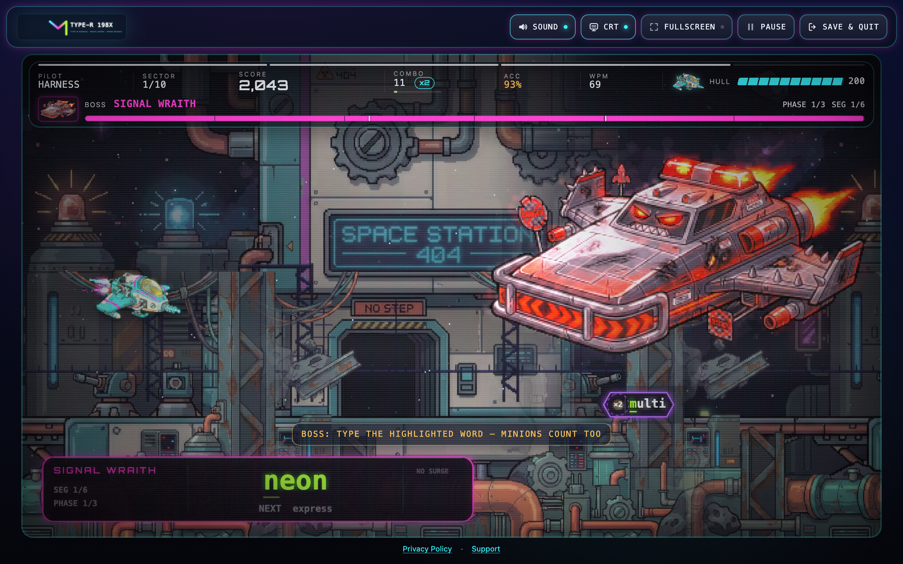

# Type-R 198X



Type-R 198X is a neon arcade typing shoot-'em-up by **Christopher Bradford**. Type the first letter of a
target to lock on, finish the word to fire, and clear ten sectors of word-bosses. It is a static web app
(plain HTML, CSS and classic JavaScript, no bundler, no runtime dependencies) that plays at
**[https://typer198x.com](https://typer198x.com)** and can be served from any static host.

This README describes the web build after the 2026 overhaul, the training update (release `20261024b`: hand-speed
WPM, typo feedback, rank lines, the pilot profile and Flight log, the first-run flight check, everyday words and
two-word targets aimed at weak keys, the Counter-Signal boss attack and Overdrive, a stream that follows the pilot's
speed with timed-out waves, hull carry and Cadet pace, and the daily sortie, drill and endless drift) and its pace
follow-up (release `20261025a`: the pace also counts how quickly the pilot finds the next target, and a wave at the
standard pace lasts and ends by the original wave rules). Release steps
live in [DEPLOY.md](./DEPLOY.md);
the play-test harness has its own [tools/playtest/README.md](./tools/playtest/README.md).

## Contents

1. [The game](#the-game)
2. [Controls](#controls)
3. [Sectors, bosses and ranks](#sectors-bosses-and-ranks)
4. [Settings, reduced motion and touch play](#settings-reduced-motion-and-touch-play)
5. [Running locally](#running-locally)
6. [Architecture](#architecture)
7. [Versioning: the two tokens](#versioning-the-two-tokens)
8. [Asset pipeline](#asset-pipeline)
9. [Music and sound](#music-and-sound)
10. [Budgets (measured)](#budgets-measured)
11. [Browser floor and render scale](#browser-floor-and-render-scale)
12. [Save data](#save-data)
13. [Play-test harness](#play-test-harness)
14. [Tools](#tools)
15. [Deployment](#deployment)
16. [Native wrappers](#native-wrappers)
17. [Privacy](#privacy)
18. [Credits](#credits)
19. [Changelog](#changelog)

## The game

- **Lock and fire.** Every enemy is a word on a plate. Typing its first letter locks the nearest matching
  plate; each further correct letter fires a shot, and the last one destroys it. Lime means "type this";
  violet is a pickup, magenta is hostile, amber is score, red is damage, cyan is chrome.
- **Words.** Half the word targets in Sectors 1-5 (30 % from Sector 6) are everyday English from a 500-word list
  (`COMMON_WORDS`, `assets/js/core/25-lexicon.js`); the rest are real neon, space and retro words (the invented words
  stay with the bosses, callouts and capsules). From Sector 4, 15 % of word targets are two-word phrases (20 % from
  Sector 7); the gap shows as a dim dot and Space types it. Once your Flight log knows your weak keys, 35 % of letters
  and words lean on them and the sector card says `THREAT INTEL · HOSTILES PROBING K · P · TH`.
- **Waves and bosses.** Every sector is three announced, quota-boxed waves, an approach and a three-phase word boss
  (four in sector 10) with typable minions. From sector 2 the boss fires a telegraphed **Counter-Signal**: it glows
  red, a red bar fills under its hull meter and the word's frame pulses; finish the whole word before the bar fills to
  counter it (bonus, the bolt bounces back), miss it and it hits for 8 + 2 x sector and the word starts over. The bar
  never gives less than 2.25 x the time the word takes at your measured hand speed, and at most two land per phase.
  Clearing a phase grants a short shield and writes a checkpoint.
- **Overdrive.** Type faster than your own speed (1.05 x this run's hand speed, else your profile's; at least 25 WPM)
  with no misses and a white arc fills around the ship; full after 2 s, the beams run white-hot and kills, boss
  letters and boss segments pay +25 % (pickups and bonuses excluded). A hard miss, a leak, a surge hit or 1 s below
  90 % of the threshold vents it. Off in Drill and the Flight Check. Before any speed is measured the threshold is a
  provisional 25 WPM that refreshes every second, so a new pilot's first Overdrive ends by the same rule.
- **Powerups.** `SHIELD`, `MULTI`, `SPREAD`, `PIERCE`, `RAPID` and `HEAL` capsules drift in; type the
  label to grab one. Combo tiers lift the score multiplier up to x5 (x7 under `MULTI`); a hard miss or
  hull damage breaks the combo. Wrong keys never cost points.
- **Four ships.** The S.S. Coconut, Little Dark One, Sofrito and HoneyBee, each with its own sprite,
  thruster and shield ring.
- **Progress.** Checkpoints every sector; retry a boss from the phase you reached or the sector from its
  start; Continue from the resume card; replay any unlocked sector from the title grid; a records modal
  keeps the top ten runs and your sector bests, and its Flight log tab keeps your typing profile (see
  [hand speed](#sectors-bosses-and-ranks)).
- **Flight check.** A fresh save flies a short check before the Sector 1 card: type `J`, finish `SPARK`, then let go
  of `COMET` with `Space` and take the nearer `LASER`. Nothing can hit you, nothing scores and nothing reaches the
  records; `Esc` or **Skip** goes straight to the sector, and returning pilots never see it. The mission briefing
  opens on three lines (lock, fire, let go) with the full story behind *Read the full briefing*.
- **Pace follows you.** At every wave the game compares your measured hand speed (this run, else your profile), plus
  the time you take to find each new target, with the sector's stream and scales it up to 2.5x: more plates at once, a
  little faster, a bigger quota. It never drops below the table on its own. A campaign wave at the table pace (nothing
  carried in) lasts and ends as it did before the pace existed (new plates still roll in a moment sooner and an empty
  field refills sooner): it ends at the table's time cap, plates still flying stay in play for a few seconds (shoot
  them or take the hit) and a wave without damage is a perfect wave. A sped-up wave, a
  wave with a carry, Cadet pace and the daily sortie get a time cap that always leaves room for the whole stream, and
  it times the wave out only while plates are still flying: they warp away without damage, the wave pays no
  perfect-wave bonus (that needs the quota met without damage) and the callout reads `WAVE TIMED OUT · N ESCAPED`;
  after wave 1 or 2 those N join the next wave. From Sector 4 a clear repairs half of the missing hull and the rest
  carries (`HULL 72% · REPAIRED +28%` on the next sector card). Two deaths in one sector add **Fly at Cadet pace** to
  Game Over: 75 % stream and damage, 80 % score, tagged CADET, until that sector is cleared.
- **Daily sortie, drill, endless drift.** Under Start, the **Daily sortie** flies one sector a day (picked from your
  top three unlocked by the local date), three waves and no boss. Your first finished or failed attempt of the day
  counts; later ones are practice. Its rating is speed x (accuracy / 100)^2 and the medal compares it with the median
  of your own rated sorties from the previous seven days (gold at 110 %, silver at 95 %; by accuracy, 97 / 93 %,
  until there are three; a sortie that ends in death earns silver at most). The card shows accuracy rounded down, so it
  never reads above the value the medal used. The tile shows today's sector, the medal, your counted sorties and the streak, and the card
  has a one-line result to copy. **Drill** is 60 s with no hull and no score at 1.1 x your speed, 60 % of it built
  from the keys and letter pair you miss or type slowest (common words when there are none yet); the card compares
  this drill's miss rate per key with your profile. **Endless drift** starts at 70 % of your speed and rises 0.3
  characters per second every 20 s until the first target gets through; your ceiling is the stream's WPM at that
  moment, with the peak 10-second speed beside it. None of them touch your saved run, high score, records, sector
  bests, Best WPM or unlocks (they do add to the Flight log); the deck unlocks once a new pilot has flown (or skipped)
  the flight check or any run.

## Controls

| Input | Effect |
| --- | --- |
| Letters | First letter locks the nearest matching target; keep typing to fire |
| `Backspace` | Release the current lock |
| `Space` | Type the gap when the locked target's next character is a space (two-word targets, Sector 4 on); otherwise release the lock |
| Three wrong keys on a locked target | The lock drops on its own ("lock lost") |
| `Esc` | Pause / resume during play; skips the first-run flight check; back out of a modal or screen; on a daily / drill / endless result card, back to the menu |
| `Enter` (or `Space` on result screens) | Advance screens; `Enter` in the pilot-name field starts the run; skips the boss intro when you have already cleared that sector, and the rest of the finale once its skip window opens (2 s) |
| Any letter during the sector card | Skips the card once you have already cleared that sector (returning players); keys are never counted there |
| `?` or `F1` | Open the help manual (title and pause screens) |
| `Alt`+`Enter`, `Cmd`+`Enter` (Mac) or `F11` | Toggle fullscreen |
| `M` | Mute / unmute on the title and pause screens |
| `Tab` | Focus navigation only; never a game key |

Letters are never shortcuts while a run is live, so `Ctrl`/`Cmd` chords, AltGr layouts and IME input
behave normally. The sector card holds keys for 1.6 s (longer only while that sector's art is still
loading); the boss intro is skippable with `Enter` once you have cleared the sector before.

## Sectors, bosses and ranks

| Sector | Boss | Sector | Boss |
| --- | --- | --- | --- |
| 01 | Signal Wraith | 06 | Sync Leviathan |
| 02 | Vector Ogre | 07 | Static Empress |
| 03 | Plasma Shogun | 08 | Logic Dragon |
| 04 | Holo Titan | 09 | Night Engine |
| 05 | Chrome Monolith | 10 | Final Electromancer |

Ten sectors share seven hand-painted art sets (`LEVEL_THEMES` in `assets/js/core/30-content.js`): the
back half revisits earlier skylines as *storm passes* (1.25x parallax, lightning, a multiply tint) and the
finale gets the crystal city. Each sector's quota, cap, target characters per second, enemy speed,
letter/word ratio, word-length window, surge cadence and minion rate come from `LEVEL_TABLE` in
`assets/js/core/20-constants.js`.

Counter-Signal cadence (`LEVEL_TABLE` `surgeEvery`, ARCADE D10): none in sector 1, every 20 s in sectors 2-3, then 14 /
13 / 12 / 11 / 10 / 9 / 8 s; the first surge of a fight arms min(6 s, surgeEvery) after the intro and the cadence runs
across phases (a phase that fired two restarts it). A surge starts at a segment start and covers the whole segment:
window `0.6 s + chars x perChar` (`perChar` .30 s at S2 down to .12 s at S10), 20 % wider when the pilot's live speed is
under 35 WPM, and never shorter than `COUNTER_SIGNAL.fairMul` (2.25) x the time the segment takes at the pilot's hand
speed (run, else lifetime, else 30 WPM; `surgeWindow`, lead ruling Z6). Boss par is `totalChars / (0.9 x targetCps)`,
so the time bonus is a tie-breaker that follows the sector's pace. Word kills use a smaller explosion (the medium
frames at .55) whose smoke sits under the plates.

The table is the floor: `assets/js/game/42-pacing.js` multiplies each wave's spawn rate and quota by
`paceMul = clamp(0.85 x pilotCpsEff / targetCps, 1.0, 2.5)` (moving at most 0.35 per wave; pilotCps = this run's hand
speed after 20 intervals, else the profile's after 60, else the table; `pilotCpsEff = L / (L / pilotCps + acq / 1000)`
with L the sector's mean target length and acq MEASURE's `typistAcquireMs()`, lead ruling Z12, see the changelog; a
wave that times out with no leak in it sets the next wave's target 0.35 below the slower of its own target and the
timed-out wave's pace, floor 1.0), adds `min(3, round(2 (paceMul - 1)))` to the alive cap and `0.15 (paceMul - 1)` to
plate speed, and from paceMul 1.35 tops an emptying field up to two plates. An empty field spawns after 0.1 s
(`HUNGRY_SPAWN_S`) and new plates roll in 10-30 px off-screen (`SPAWN_ROLLIN_PX`). A wave's cap is `max(table cap,
1.25 x the stream's delivery time for the paced quota + 4 s)` (`paceWaveCap`, lead ruling Z5) and ends the wave only
while plates are alive; an empty field lifts it and the wave ends by quota. A campaign wave at exactly paceMul 1.0 with
no carry is a floor wave (`waveTuning.floor`, lead ruling Z13): it keeps the table cap and `20261016a`'s spawn rate,
and its cap ends it whatever is on the field (plates still up stay in the drain), with no timeout, escape, carry or
back-off.

Every results card stamps a rank from `rankFor(accPct, wpm, hpPts, level)`: accuracy 50 %, speed 30 %, hull 20 %
(`RANK` in 20-constants.js, thresholds S 0.90 / A 0.75 / B 0.55 / C 0.35, D below). Speed is hand speed (below) and
every sector measures it against its own stream rate (`targetCps x 12`): the speed term runs from 0.5 x nominal to
1.22 x nominal, never wider than the absolute 20-60 WPM window, so a pilot at about the sector's nominal WPM with 98 %
accuracy and no damage reaches S (S at 98 %: 15 WPM in S1, 28 in S3, 36 in S4, 42 in S5, 47 from S7). A line under
the stamp names the term that held the rank back and the value for the next grade
(`ACCURACY HELD YOU BACK · 93% · S AT 95%`); an S shows none, and Game Over names the cause instead
(`SIGNAL LOST · 4 WORDS LEAKED IN WAVE 2`). The ACC tile is captioned with the miss count and up to three
WEAK SIGNAL chips follow the tiles (the most-missed key, the slowest letter pair, `STEADY nn%`). The balance numbers
live in [tools/playtest/balance.md](./tools/playtest/balance.md).

**WPM is hand speed.** `assets/js/game/32-typist.js` times the gap between consecutive correct keys inside one
target (plate, capsule or boss segment); the first key of each target, gaps over 1.5 s and sub-10 ms bursts are left
out, and wrong keys stay inside the gap, so errors cost speed. WPM = 12000 x intervals / total ms. The HUD shows the
last 30 intervals (`--` before 10), the cards the sector or run figure, Best WPM the best cleared campaign sector
with at least 60 intervals. The gross characters-per-time figure survives as `results.throughput` for tooling and as
THROUGHPUT in the Flight log. The HUD ACC cell reads `--` until 10 keys, turns amber below 95 % and red below 90 %,
and pulses on each hard miss. A wrong key while locked shows the typed glyph struck through inside the plate; a
wrong key with nothing locked pops the glyph off the gun and pulses the nearest plate's lead letter. Records ->
Flight log shows per-key misses and latency on a keyboard, slowest keys, weak keys, a speed / accuracy sparkline of
the last 20 sessions, per-sector best speed and accuracy, mode bests (the best endless ceiling and the best drill),
days flown and a goal line built from the last five sessions (also on the title screen, under Best WPM).

## Settings, reduced motion and touch play

The settings panel (title screen link row or the pause screen) has **Music** (default 70 %), **SFX**
(80 %), **Mute**, **CRT filter** and its **intensity** (on, 75 %), **Motion** (*Follow system* /
*Reduced* / *Full*), the accessibility rows below and a **Fullscreen** button. All of it persists in the save.

**Accessibility options (PLATFORM, `assets/js/game/12-access.js`).** Six more rows in the same panel, each stored in
`save.settings` (defaults and sanitising in `40-save.js`) and applied through the shell's `setSetting` / `applySettings`
path, which `12-access.js` wraps; the render modules are untouched (prototype wrappers, installed on the first
`applySettings` call once every module has loaded):

| Row | Key | Values (default) | Effect |
| --- | --- | --- | --- |
| Plate colours | `plateColor` | `neon` / `contrast` (`neon`) | High contrast swaps the `PLATE_STYLES` strokes for a colour-blind-safe set with distinct luminance (idle `#E8ECF8`, locked `#FFD60A`, danger `#FF7A00`, minion `#C9A4FF`; 17.1 / 14.3 / 7.7 / 9.9 : 1 on the `bg0` plate fill) and re-bakes the plate sprites, and adds two shape cues drawn from the `renderOverlay` hook (source-over only): a second, white bracket pair outside the lime lock brackets and a dashed hazard underline under plates past the danger line |
| Plate font | `plateFont` | `mono` / `dyslexic` (`mono`) | Dyslexia-friendly swaps `FONT.target`'s family for **TypeR Dyslexic Mono** (OpenDyslexic Mono built from the OFL sources, Basic Latin + Latin-1 subset, 13 KB WOFF2 in `assets/fonts/`, licence in `OFL-OpenDyslexic.txt`). Never preloaded: fetched with `document.fonts.load` when chosen, applied only once it is resident (a failed load keeps mono and says so in a toast). Everything typable (plates, capsules, boss segments) follows; there is no separate typed-text field to restyle |
| Plate size | `plateScale` | 1 .. 1.3 step .1 (1) | Multiplies `plateFontPx()` (so `plateGeometry()` scales with it): 25 -> 33 px glyphs, 45 -> 60 px plates at 130 %, still inside the 68 px lane pitch; the plate sprite cache is invalidated and re-warmed on change |
| Screen shake | `shakeAmount` | 0 .. 1 step .1 (1) | Scales `motion().shake`, independent of the Motion row (0 = no camera offset at all, even at full motion) |
| Reduce flashes | `reduceFlashes` | off / on (off) | Caps `motion().flash` at .3 (the reduced-motion value) and drops the storm lightning frames while keeping the storm tint |
| Keyboard layout | `keyboardLayout` | `auto` / `qwerty` / `azerty` / `qwertz` / `dvorak` / `colemak` (`auto`) | Only arranges the Flight log's key heatmap (`keyboardRows()`). Auto reads `navigator.keyboard.getLayoutMap()` where it exists (Chromium) and classifies the layout from the characters at KeyQ KeyW KeyY KeyA KeyZ KeyS (`keyboardLayout()` falls back to QWERTY). Typing itself reads `event.key` (`normalizeKey`, 00-util.js) and needs no layout: an AZERTY `a` is an `a` |

Public methods: `game.plateScale()`, `game.shakeAmount()`, `game.reduceFlashes()`, `game.plateColorMode()`, `game.plateFontMode()`,
`game.keyboardLayout()`, `game.keyboardRows()`, `game.accessInfo()`; the wrapped `game.motion()` returns one reused object when a
scale applies. `tools/playtest/probes/t-platform.mjs` is the acceptance set (round-trip through reload, palette contrast
from `assets/style/palette.json`, cue pixels, geometry, shake, flashes, heatmap rows, install / update UI, the frame budget
under High contrast, and the service worker in an opt-in context).

**Reduced motion.** `resolveMotion()` sets `game.reduceMotion` and the `:root.reduce-motion` class from the
Motion setting, falling back to `prefers-reduced-motion`. Under it the camera does not shake, hit-stop and
slow-motion are off, warp streaks, bobbing, spawn pops, typewriters and slams become fades, flashes are
capped and the attract mode drifts at a lower rate. A hidden `settings.renderScaleCap` (default 2, no UI
row) caps the canvas backing store; see [render scale](#browser-floor-and-render-scale).

**Touch play.** Tapping the playfield focuses a hidden text input so the soft keyboard appears; typed
characters arrive through `beforeinput`/`input` and are routed to the same `handleTyped()` path as key
presses. Phones get a four-lane landscape profile with its own plate geometry (plate glyphs are 14 CSS px on an
iPhone 13 in landscape), a rotate hint in portrait and an on-canvas pause button in immersive landscape. The phone
profile is landscape-only by design: portrait is the "rotate your phone" state. A hardware keyboard remains the best
experience.

## Running locally

```bash
./launch-game.command          # macOS: python3 http.server on :8000 and opens the game
python3 -m http.server 8000    # any OS, from the repo root; open http://localhost:8000/
```

The game also boots straight from `file://index.html` (the classic scripts need no server and the loader
and the audio transport switch to bare, unversioned paths on a `file:` origin), but a local HTTP server
is the reference setup because it exercises the same cache and range-request paths as production.

### Install (PWA) and offline

The web build is an installable, offline-capable PWA (PLATFORM pass): `site.webmanifest` (name *Type-R 198X*, short name
*Type-R*, `start_url ./?source=pwa`, standalone, landscape, `#0B1030`, icons 192 / 512 in `any` and `maskable` purposes under
`assets/ui/icons/`, rendered from `assets/ui/mark.svg` by `tools/gen-pwa-icons.mjs`) and the service worker `sw.js` at the web
root (scope `/`).

- **Registration.** `registerServiceWorker()` (12-access.js) runs from `finishLoading` in 05-boot.js, after the first load and an
  idle callback, only on `http(s)`, never under the native user agent and never when `window.TypeRHarness.sw === false`, which
  `tools/playtest/play.mjs` and `probes/_lib.mjs` set in every harness context so no run ever measures a cached shell
  (`probes/t-platform.mjs` opens its own `{ sw: true }` context to test the worker).
- **Versioning.** `sw.js` carries `const SW_VERSION = "<shell token>"`; `tools/bump-version.sh` rewrites it together with every
  `?v=` inside the worker's `PRECACHE` list (same URL rule as the pages). A new token is a new worker: it installs beside the running
  one, and the page shows **NEW VERSION READY — RELOAD** (a clickable toast plus the **Reload to update** link in the title's link
  row) only at the menu, never during a run; the worker swaps (`SKIP_WAITING`) and the page reloads when the player asks.
  Old caches are deleted on activate.
- **Precache.** `tools/gen-sw-precache.mjs` writes the `PRECACHE` block of `sw.js` from `index.html` (every local `<script>` /
  `<link>`, the secondary pages, the manifest, `assets/fonts/*.woff2`, `assets/ui/**`; 69 entries, no `assets/opt` art). Run it
  after adding a script or a UI asset; `tools/deploy-check.sh --local` fails when the list is stale (`--check`). Install adds the
  entries one by one and swallows failures, so a stale list never breaks the page.
- **Strategies.** Navigations are network-first with a cache fallback (the page, else `index.html`); `assets/opt/**` (versioned,
  immutable) is cache-first in a release-independent store capped at 60 MB (oldest out) — a media range request is answered from a
  cached full copy, an open-ended `bytes=0-` request streams the network body to the player while the same bytes are stored, other
  ranges pass through; everything else is the precached shell copy, else stale-while-revalidate. `/api/` is never intercepted.
- **Install.** The **Install** link in the title's link row appears only after `beforeinstallprompt`, calls `prompt()` once and
  hides after `appinstalled` or in `display-mode: standalone` (`<html data-display="standalone">`). Installed, the fullscreen
  toggle still works and Esc still pauses; the page footer gets the home-indicator inset.
- **Hosting.** `tools/deploy/htaccess-cache.txt` serves `sw.js` and `site.webmanifest` `no-cache` and adds the
  `application/manifest+json` type; `deploy.mjs` lists `sw.js` in `TOP_FILES`; `tools/deploy-check.sh` checks both files, the
  `SW_VERSION` / shell-token match and the icons (remote and `--local`).
- **Privacy.** The worker stores the game's own files and nothing else; [privacy-policy.html](./privacy-policy.html) says so.

## Architecture

The browser build is a set of **classic scripts** loaded in a fixed order by `index.html`. Top-level
`const`/`class`/`function` declarations in one file are visible to every later file (one shared global
lexical scope), so a file may only reference names defined earlier at its own top level; method calls at
runtime can go anywhere. Every `assets/js/game/*.js` file is an `Object.assign(Game.prototype, {...})`
mixin. `tools/check-globals.sh` fails on a duplicate top-level name (a duplicate `const` is a
`SyntaxError` that silently disables the later file).

Module map, in `index.html` load order:

| File | Role |
| --- | --- |
| `assets/opt/manifest.js` | Generated: `window.TYPER_ASSET_MANIFEST` (keys, variants, trim and content boxes, music list, ART version) |
| `assets/audio/sfx.js` | IIFE: `window.SFX`, the Web Audio bus, cue registry, streamed music transport with loop points |
| `assets/js/core/00-util.js` | `clamp/lerp/rand/...`, `normalizeKey/foldLatin`, `IS_FILE_ORIGIN`, `IS_NATIVE_SHELL`, the `GAME_HOOKS` registry (`onGameHook` / `runGameHooks`) the training-update files listen on |
| `assets/js/core/10-tokens.js` | `PALETTE` / `FONT` / `MOTION` / easings / `SHAKE_PAD`: the CSS design tokens mirrored into JS |
| `assets/js/core/20-constants.js` | Timing and balance constants, `LEVEL_TABLE` -> `LEVELS`, `RANK`/`rankFor`, powerups, `buildBossSegments` |
| `assets/js/core/25-lexicon.js` | `COMMON_WORDS`, `PHRASES`, the wave-pool mix (`lexiconAttachLevel`: common / two-word shares, `waveTextLen` for the spawner's cps), two-word plates (Space types the gap, the gap dot), weak-key bias from MEASURE's profile, THREAT INTEL; GAME_HOOKS listeners only (WORDS) |
| `assets/js/core/30-content.js` | Word pools and letter sets, boss tables, ship configs, `LEVEL_THEMES`, explosion sheet, victory script |
| `assets/js/core/40-save.js` | `LS_KEY`, schema 3 `defaultSave`, `loadSave`/`storeSave`, `migrateSave`, checkpoints and resume helpers |
| `assets/js/core/50-assets.js` | `Assets` IIFE (`window.TypeRAssets`): manifest-driven image loader, variants, prepare, prefetch, gc |
| `assets/js/core/60-entities.js` | `Enemy`, `Powerup`, `Bullet`, `ExplosionSprite`, `Particle`, `Boss` |
| `assets/js/core/70-canvas.js` | Stateless canvas helpers: `roundRect`, `bracketRect`, `drawSplitText`, `fitText`, `drawTracked` |
| `game.js` | `ASSET_VERSION`, the stale-shell guard, `withAssetVersion` (literal line kept for the native sed), `class Game { constructor, loop }`, `hook` / `runMode` / `rand` |
| `assets/js/game/05-boot.js` | Boot sequence, loading overlay and watchdog, per-sector asset gate, prefetch of the next sector (from the page's first typed key) |
| `assets/js/game/10-ui.js` | Shell: `setMode` state machine, focus routing, announcer, modals and confirms, settings + `resolveMotion`, fullscreen, top bar, mobile input |
| `assets/js/game/12-access.js` | PLATFORM: the accessibility rows (plate colours / font / size, screen shake, reduce flashes) as wrappers over `plateFontPx`, `motion`, `drawThemeFx`, `FONT.target` and `applySettings` / `bindSettings`, the high-contrast `PLATE_STYLES` swap + `renderOverlay` shape cues, keyboard layout detection (`keyboardLayout` / `keyboardRows`), the service-worker registration and update toast, the Install link (`ACCESS_*`, `access*`) |
| `assets/js/game/15-screens.js` | Title cabinet (sector grid, resume card), records and help modals, results cards, tutorial toasts, CRT overlay and the typewriter ending |
| `assets/js/game/17-onboarding.js` | First-run Flight check (ONBOARD): eligibility, the three drills, Skip / `Esc`, pause relabel, the briefing summary and disclosure, the `TypeRHarness.flightCheck` flag |
| `assets/js/game/20-run.js` | Run and sector lifecycle, checkpoints, `saveRun`, level complete / game over / victory |
| `assets/js/game/30-input.js` | Keydown routing, `handleTyped`, lock rules (release, three-miss loss), scoring hooks |
| `assets/js/game/32-typist.js` | Hand speed (qualifying intervals, live / window / sector / run / lifetime), per-key and bigram profile (`save.profile`), weak keys, sessions and bests, the typo pair / gun pop, HUD ACC / WPM providers, rank line / WEAK SIGNAL / Game Over cause, Flight log, goal line (MEASURE) |
| `assets/js/game/40-combat.js` | Spawning, lanes, waves (a Z5 cap ends a paced wave only with plates alive; a floor wave's table cap always ends it) and approach, kills, powerups, damage, `update(dt)` |
| `assets/js/game/42-pacing.js` | Pace controller (`paceMul` per wave from MEASURE's speed and acquisition time into `waveTuning`), floor waves (paceMul 1.0, no carry) on the table's wave rule, perfect wave by quota, computed wave caps, timed-out waves (the escaping plates) and their quota carry, hull carry from sector 4, the Cadet assist and the `diff()` row (PACE) |
| `assets/js/game/45-feedback.js` | Banner system (sector, wave, boss intro/clear, callouts) and score floaters |
| `assets/js/game/50-boss.js` | Boss v2: phases, minions, intro and finale; Counter-Signal (surge cadence, `surgeWindow` from the pilot's speed, telegraph, fail reset, counter, DOM charge bar) (ARCADE) |
| `assets/js/game/52-modes.js` | Daily Sortie (date seed, per-wave mulberry32 through `this.rand()`, medal, streak, share line), Endless Drift and Drill streams (`waveTuning`, own text picker), the title deck, the mode results screen, `save.modes` (MODES) |
| `assets/js/game/60-hud.js` | DOM HUD with write-on-change diffing: score, combo and multiplier, HP meter, chips, boss meter |
| `assets/js/game/70-render.js` | `resizeCanvas`/`renderScale`, plates, capsules and rails, dying and escaping plates, boss art (Counter-Signal glow) and console slab, warp-in, storms, parallax, stars, `render()` in layer order |
| `assets/js/game/72-atmos.js` | ATMOS: parallax tiles baked once per sector into offscreen canvases with a seam-dissolve edge (the masters do not wrap), a per-sector multiply tint + saturation pull + lane haze, and a hue shift for sectors 6 / 8 / 9 that share art with 3 / 4 / 5 (`ATMOS_GRADES`) |
| `assets/js/game/75-fx-draw.js` | Ship, beams, rings/bolts/debris, particles, overlays, vignette, active-target redraw |
| `assets/js/game/76-bloom.js` | BLOOM: the frame so far drawn at quarter resolution, multiplied by itself twice (luminance^3 threshold), blurred by a 1/16 round trip and added back at `BLOOM.alpha`; two offscreen composite sets per frame, self-disables when its own cost stays above `BLOOM.budgetMs` |
| `assets/js/game/78-bossfx.js` | BOSSFX: overrides `drawBossArt` / `drawBossDissolve` with roll + breathing + phase punch, an emissive pulse extracted from the sprite (luminance^3, no pixel reads), three damage states baked per fight (seeded scorch blotches, cracks, char) with a crossfade, intro slide ghosts, sparks and smoke from the tick hook (`BOSSFX`) |
| `assets/js/game/80-fx.js` | Effects clock: trauma camera and `shakeOffset`, hit-stop/slow-mo, flash channels, `onKeyFx`/`onKillFx`, ambient step |
| `assets/js/game/82-overdrive.js` | Overdrive: burst meter relative to the pilot's speed (MEASURE's intervals), the shield-ring arc, white-hot beams / plume, +25 % on kill / boss-letter / segment score, vent / slow exit, card note, `pilotWpm()` (ARCADE) |
| `assets/js/game/85-attract.js` | Attract mode on the title screen: ghost plates from `LEVELS[0].words`, selected-ship cruise, 20 fps drift after 90 s idle (`startAttract`/`stopAttract`/`updateAttract`/`drawAttract`) |
| `assets/js/99-boot.js` | `const game = new Game(); window.game = game; window.TypeRDebug / TypeRAssets` |

Adding a file means adding its `<script>` tag at the right position with the same `?v=` token as its
neighbours and running `tools/check-globals.sh`.

Other rules the code follows: no `shadowBlur` or `filter` in per-frame canvas paths (glows are baked into
cached sprites keyed by `spriteEpoch`), no full-frame translucent fill above alpha .12 (the storm tint is
the one documented exception), meters animate with `transform: scaleX`, DOM writes only on change, colours
come from `PALETTE` / CSS variables rather than literals.

## Versioning: the two tokens

1. **Shell token** (`YYYYMMDDx`, e.g. `20251130a`): the `?v=` on every `<script>`/`<link>` and in-site `<a href>`
   page link in the HTML pages (and the `privacy.html` refresh), `<meta name="asset-version">` and
   `const ASSET_VERSION` in `game.js`. `tools/bump-version.sh`
   is its only writer:

   ```bash
   tools/bump-version.sh 20261025a            # rewrite every shell token (index, info, support, privacy pages, game.js)
   tools/bump-version.sh                      # today's date + next letter
   tools/bump-version.sh --dry-run            # report only
   tools/bump-version.sh --add-missing        # also stamp script/stylesheet tags that have no ?v= yet (never the font preload)
   tools/bump-version.sh --root /tmp/copy     # rehearse on a copy
   ```

   It leaves the `withAssetVersion` literal line in `game.js` untouched because `native/sync-web.sh`
   patches that exact line, and `--add-missing` never stamps the Orbitron `<link rel="preload" as="font">`:
   its `href` must stay byte-identical to the `@font-face` `url()` in `assets/style/tokens.css`, otherwise the
   browser preloads one URL, fetches another for the face and warns about an unused preload.
2. **ART token**: the `"version"` in `assets/opt/manifest.json` (and the identical value in
   `manifest.js`), written by `tools/build-web-assets.sh`. `Assets.url()` and the music transport append
   it to every `assets/opt/*` URL; `bump-version.sh` stamps it on any `assets/opt` URL that appears in the
   HTML (`<script>`, `<link>` and the ship-card `` tags). `manifest.js` itself takes the **shell** token
   because it is part of the shell.

Production must serve the HTML pages, `/` and `manifest.js` with `Cache-Control: no-cache` and every
versioned URL as immutable; see [Deployment](#deployment). Bump the shell token before every deploy.
While the host still answers `/index.html` and the other pages with `max-age=15552000`, `staleShellGuard` at the top
of `game.js` covers a stale shell **that runs this release's `game.js`**: when the page has no `assets/js/` scripts (a
pre-overhaul shell) or an `assets/js/` tag carries a `?v=` other than `ASSET_VERSION` (an older modular shell whose
old `game.js` is no longer in the browser cache, so its versioned URLs return this release's code because the server
ignores the query), it reloads once with `?v=<ASSET_VERSION>` and stops if that query is already there. It cannot
reach a browser that cached the whole older build at `/index.html` (shell and scripts: the normal state after the
footer pages' "Back to the game" links): that browser runs the old build with zero requests until the player
reloads, opens `/` (served no-cache) or the cache expires. Nor does it reach a mixed cache: a browser that still holds
the older `/index.html` and the older `game.js` but has lost one of the other `assets/js/` scripts fetches that
script's old `?v=` URL, gets this release's file (the host ignores the query) and runs old and new code together.
Resume can do nothing, plates can stop spawning or a boss can stop taking damage, with `[TypeR] frame error` in the
console, until the player reloads once (the reload revalidates `/index.html` and the new shell's `?v=` URLs are all
new). It is rare (the browser must evict one script but keep the shell and `game.js`), loses no data, and the
20261016a -> 20261024a step had the same gap. Once a returning browser runs this shell (a save exists,
or it arrived through `?v=`), the guard revalidates `/index.html`, `privacy-policy.html`, `support.html` and
`info.html` at idle after the first keystroke (30 s after load when the player never types, so it stays out of the
boot budget) with `cache: "no-cache"` (a 304 without a body while the copy is current, the new page once
after a release; nothing is stored), and every in-site page link carries `?v=<shell token>` (`bump-version.sh`
rewrites the `<a href>` tokens and the `privacy.html` refresh), so the footer pages, their back links and the next
`/index.html` visit are this release. It never runs on a `file:` origin or under the native user agent.
`tools/deploy-check.sh` fails when the served tokens disagree, `manifest.js` differs from the local one, or an
`assets/opt` token on the shell (the ship cards) differs from the manifest version.

## Asset pipeline

Since the 2026-10-31 presentation pass the ship and boss masters are themselves pixel art (`tools/art/pixelize.py`
over the original cel-shaded illustrations: ships at one art pixel per 1.4 logical px, bosses at one per 2 logical px,
the backdrops' density) and the explosion sheet is generated (`tools/art/gen_explosions.py`). The originals are in git
history at `v20261025a`; `tools/art/README.md` has the parameters and the revert command.

The browser build never downloads the PNG/WAV masters. `tools/build-web-assets.sh` encodes them into
`assets/opt/` (committed) and writes the manifest:

| Output | Contents |
| --- | --- |
| `assets/opt/bg/<id>@1x.webp`, `@2x` | Backgrounds 1408 / 2816 px wide (ten sets; `seventh/eighth/ninth` are the generated vistas for sectors 6 / 8 / 9, `tools/art/gen_vista.py`) |
| `assets/opt/fg/<id>@1x.webp`, `@2x` | Foreground parallax layers with alpha |
| `assets/opt/bosses/<n>@1x.webp`, `@2x` | Trimmed boss art (trim box and opaque box recorded in the manifest) |
| `assets/opt/ships/<id>@1x.webp`, `@2x` | Trimmed ship art |
| `assets/opt/fx/explosions.webp` | Explosion sprite sheet at full resolution |
| `assets/opt/audio/*.mp3`, `laser.wav`, `bigexplosion.wav` | Music (VBR ~190 kbps) and the two compact mono one-shots |
| `assets/opt/manifest.js` / `manifest.json` | `window.TYPER_ASSET_MANIFEST` for the page, the same data for tooling, plus the ART version |
| `assets/ui/og-card.jpg` | 1200x630 social card rendered from `assets/screenshot.png` (<= 250 KB) |

```bash
tools/build-web-assets.sh                  # full re-encode (minutes; needs ImageMagick 7 `magick`, cwebp, ffmpeg)
MANIFEST_ONLY=1 tools/build-web-assets.sh  # regenerate manifest.js/json (+ og-card) from the existing files, new ART version
OG_ONLY=1 tools/build-web-assets.sh        # only render assets/ui/og-card.jpg
SKIP_OG=1 tools/build-web-assets.sh        # skip the og-card step
```

**`Assets` loader** (`assets/js/core/50-assets.js`, also `window.TypeRAssets`): reads the manifest and
loads images on demand. The loading screen waits only for the critical set (four ships, `bg/first`,
`fg/first`, `fx/explosions`); each sector's background, foreground and boss load when the sector starts
and the next sector is prefetched a quarter of the way through (once the pilot has typed in this page session, so a
run resumed past that point does not fetch it before the first keystroke) and during the finale; images are
decoded off the main thread into bitmaps at the size they are drawn (`x2` files above `renderScale` 1.25,
`x1` otherwise; `Save-Data` forces `x1`); a WebP that fails to load falls back to its PNG master and a key
that still fails is reported once so the loading screen can offer *Retry* and *Continue* (procedural
fallbacks). On a `file:` origin or under the native user agent every URL is bare (no `?v=`).

```js
Assets.init({ renderScale });                 // once, after resizeCanvas()
Assets.loadMany(keys, onProgress)             // -> Promise; onProgress({loaded, total, key})
Assets.load(key) / Assets.get(key)            // Promise<drawable|null> / drawable or null (never cache across frames)
Assets.sprite(key, targetOrigW)               // {img, x, y, w, h}: trimmed crop placed in the untrimmed frame
Assets.contentRect(key, targetOrigW)          // opaque box in the same frame (boss composition)
Assets.meta(key)                              // {orig, crop, content, variants, ...} in original px
Assets.url(key, variant?)                     // versioned URL (bare under file:// or the native UA)
Assets.prepare(key, {w, h, scale?})           // re-prepare a bitmap at a different draw size (>10 % change)
Assets.setRenderScale(s)                      // variant flip and re-prepare in the background
Assets.levelKeys(i) / loadLevel(i) / prefetchLevel(i)
Assets.pin(key) / unpin(key) / gc(keepKeys) / release(key)
Assets.sheetScale('fx/explosions')            // 0.5 at x1, 1 at x2 (ExplosionSprite.sheetScale fallback; draws derive it per frame)
Assets.retryFailed()                          // re-request every errored key
Assets.on('progress'|'ready'|'error', fn) / off(...)
Assets.stats()                                // decodedPx, bootReason, resident keys, errors
Assets.variant / renderScale / version / manifest / pinned   // getters
```

`cd tools/playtest && node probes/assets-loader.mjs` exercises the loader (HEAD on every manifest URL,
fallbacks, sprite maths, prefetch, gc, native-UA bare paths, synthesised manifest).

## Music and sound

Everything audio lives in `assets/audio/sfx.js`. The six *Galactic High Score* tracks are **streamed
MP3s** (`assets/opt/audio`): two `HTMLMediaElement`s per track feed the Web Audio bus and hand over at a
measured loop point with a 0.6 s equal-power crossfade, so a sector's music never stops or re-downloads.
`MUSIC_FOR_LEVEL = [0,5,2,2,1,1,4,4,3,3]` keeps the one duplicate song (tracks 1 and 6) inside the
sector 1-2 tier; the same track across adjacent sectors is left running, a tier change crossfades.
`MUSIC_LOOP` is measured, not guessed: `tools/measure-loops.sh [audio-dir]` (ffmpeg + node, about a
minute) finds the sustained body of each track, beat-aligns the loop end and prints a paste-ready table;
the method is summarised above the constant and in the harness README.

The two one-shots (`laser.wav`, `bigexplosion.wav`) are decoded buffers; every other cue is synthesised.
Audio unlocks on the first gesture (Start/Continue), mute is a master gain so unmuting resumes mid-track,
pause applies -6 dB and a low-pass, hidden tabs pause the transport. Defaults: music 0.7, SFX 0.8.
`tools/playtest/probes/audio-contract.mjs` and `audio-lifecycle.mjs` are the acceptance sets.

## Budgets (measured)

Numbers from the harness at a 1440x900 viewport. The byte, frame-rate and render rows were re-measured for release
`20261024b` with `play.mjs --scenario all` at DPR 1 and 2 (training at the copy pass, `e15b279`); the art rows are
unchanged because the training update adds no art:

| Metric | Measured | Budget |
| --- | --- | --- |
| Non-media bytes finished before the first keystroke | 2.11 MB at DPR 1, 2.57 MB at DPR 2 (1.94 / 2.39 for `20261024a`); 2.34 MB for the `fixture-legacy-inboss` matrix row, which loads a boss before its first keystroke | <= 2.5 MB at DPR 1, <= 2.75 MB at DPR 2 and for `fixture-legacy-inboss` (CONTRACT 8.y W2, 8.z Z11) |
| `assets/opt` (everything the web build can download) | 29 MB | <= 35 MB whole game |
| Frame rate (menu, gameplay, boss, finale windows) | 60 fps at DPR 1 and DPR 2 | >= 58 |
| `render()` wall time | 3.7 ms max at DPR 1, 8.1 ms at DPR 2 | <= 16 ms |
| `shadowBlur` sets per frame in steady state | 0 | <= 2 |
| Translucent full-frame fill alpha | .12 (storm tint .22 multiply is the documented exception) | <= .12 |
| Decoded bitmap pixels at DPR 2, sector 1 | ~10.9 Mpx (~19 Mpx with the next sector prefetched) | <= 12 Mpx resident |

Known and tracked: `layoutCountPer5s` while typing reads 15-35 with the probe run alone (34.2 at DPR 1 and 30.8 at
DPR 2 for `20261024b`, 14.9 / 25.7 for `20261024a`; the window tracks how many keys and callouts land in it; target
<= 40 per 5 s: the 5 Hz HUD commits plus event-driven writes, see `probes/e2-layout.mjs`); idle play is about 4
(`layoutCountPer5sIdle` 3.9 / 3.5); the
first frame of a sector entered by a direct `startLevel(i)` jump costs 45-80 ms at DPR 2 (GPU upload;
`advanceLevel` is pre-warmed and does not hitch).

## Browser floor and render scale

**Safari 14.1+, Chrome 87+, Firefox 103+.** An ES5 boot guard in `index.html` feature-tests `??=` and
`?.` and shows that message instead of a broken page on anything older. `inert`, `100dvh`,
`createImageBitmap(resize)` and WebP need Safari 15.x, so the Tab-trap fallback, the canvas resize
fallback and the PNG-master fallback are mandatory parts of the build, not options.

**Render scale.** The playfield is a logical 1280x720. `resizeCanvas()` sets the backing store to
`round(1280 * renderScale)` with `renderScale = min(settings.renderScaleCap, clientWidth * devicePixelRatio / 1280)`
clamped to 0.5..2, and applies `setTransform(renderScale, ...)`, so gameplay maths never changes. At the
harness viewport `#main` is ~1372 CSS px wide, so a DPR-2 display gets `renderScale` 2 (a 2560x1440 store)
and `canvas.width / clientWidth` is ~1.87, not 2. Bitmaps are prepared at `logical x renderScale` device
pixels and drawn at logical size; a `renderScale` change above 10 % re-prepares them in the background.
Lower `settings.renderScaleCap` in the save (hidden setting, default 2) to trade sharpness for fill rate
on an integrated GPU.

## Save data

One `localStorage` key, **`typesmup198x.save.v1`**, schema 3 (`assets/js/core/40-save.js`):
`playerName`, `selectedShip`, `highScore`, `lastUnlockedLevel` (1..10), `storySeen`, `settings`
(`muted`, `crt`, `musicVolume`, `sfxVolume`, `crtIntensity`, `reduceMotion`, `renderScaleCap`, and the PLATFORM rows
`plateColor`, `plateFont`, `plateScale`, `shakeAmount`, `reduceFlashes`, `keyboardLayout`),
`highScores` (top 10), `sectorBests` ("1".."10" -> score, rank, wpm, acc, maxCombo, date), `bestWpm`,
`victories`, `tutorialSeen` (the overhaul's tips plus `phrase`, the first two-word tip, one write per save lifetime,
and `surge` / `overdrive`, the first Counter-Signal and Overdrive tips), `onboardingDone` (ms epoch when the first-run
flight check was passed or skipped, 0 = not yet; written once, never on quit-to-menu; `migrateSave` keeps it),
`profile`, `modes` and `run` (the live campaign run with `checkpoint`, `boss`, `bossCheckpoint`, `stats`,
`levelStats`, `spd`, `pace`).

Schema 3 adds `profile` (created on the first key): `keys` (`a`..`z` -> `{n, err, ms}`, attempts, miss EMA .05,
latency EMA .15), `bigrams` (top 200 by attempts), `speedEma` / `thrEma` / `speedN`, `acqEma` (the lifetime
acquisition EMA in ms, absent until a run reaches 10 samples), `sessions` (last 100 as rows
`[t, mode, sector, speed, acc, rank, score, misses, steady, weak]`, read through `typistSessions()`; one per campaign
sector cleared or lost and one per finished daily sortie, drill or endless drift, `speed` 0 under 10 intervals, `acc`
null under 10 keys), `sectorBest` (campaign clears only), `bests` (`speed`, the campaign Best WPM; `ceiling`, the best
endless ceiling; `drill`, the best-rated drill `{speed, acc}`) and `days`. The profile is capped at 16,384 B of JSON
(oldest sessions dropped first; worst case measured 13,102 B). Run records carry `run.spd` and
`levelStats.spdN/spdMs/spdSq/hits`.

`modes` (MODES, created by the first finished mode run, at most 8 KB; 7,129 B measured after 61 days): `daily`
(`today {date, sector, attempts}`, `days` = the newest 60 counted days `{sector, rating, medal, speed, acc, result, t}`
keyed `YYYYMMDD`, `flown` = counted sorties, `streak {n, last}`), `endless {best {ceiling, timeMs, peak, acc, t}, runs}`,
`drill {best {speed, acc, t}, runs}`. A mode run is never stored as `run` and writes the save exactly once, when it
ends; its session (mode `daily` / `endless` / `drill`) and the ceiling / drill bests go into `profile` through MEASURE.

`run.pace` (PACE, < 400 B, normalised on first read): `{v, mul, cpMul, applied {level, wave, mul, quota} | null,
carry, carryTo {level, wave} | null, backoffTo {level, wave} | null, waveMuls[<=3], cadetLevel, usedCadet,
deaths {level, n}, hullNote {level, pct,
rep, shown} | null}`; `run.hp` after a clear of sectors 4-9 is the repaired hull. Records rows of a run that flew
Cadet pace carry `difficulty: "cadet"` and `tags: ["CADET"]`; a sector best set at Cadet pace keeps its `tags`.
ARCADE adds `overdriveMs`, `csCountered` and `csFired` to the run stats and `overdriveMs` / `surgesFired` to the level
stats (and their checkpoint copies). PACE and ARCADE write nothing themselves: their state rides the existing save
points. With `profile` (<= 16 KB), `modes` (<= 8 KB), the run and everything else (4 KB each) the whole save stays
within 32 KB.
Migrating a schema < 3 blob flags every `highScores` row and `sectorBests` entry `wpmLegacy: true` (the records table
dims them) and freezes `bestWpm` as a legacy number. The tables are folded into the save only inside `storeSave`;
typing adds no write.

`migrateSave()` is idempotent and brings any pre-overhaul blob (the same key, no `schema`)
up to date: legacy runs get `id`, `startLevel`, `legacy: true` (their high score still counts), deep-merged
stats, a clamped `levelT`, and a legacy in-boss run without boss state re-enters through the approach
phase. `storeSave()` keeps playing from memory with a toast when storage is unavailable. **Reset save** on
the title screen (link row under the pilot stats) erases everything after a confirmation. The harness
fixtures under `tools/playtest/fixtures/` are the regression set for every legacy shape.

## Play-test harness

`tools/playtest/play.mjs` is a headless Playwright driver that serves the repo on a random port (correct
MIME types, byte ranges, the production cache policy), plays like a configurable typist, forces the boss,
game-over and victory paths, and writes `report.json` plus numbered screenshots. Exit code 1 on any page
error or non-resource console error.

```bash
cd tools/playtest && npm install                      # once (Playwright, Chrome channel)
node play.mjs --root ../.. --out ./out/all --scenario all --dpr 2
node play.mjs --root ../.. --out ./out/smoke --scenario smoke
bash run-matrix.sh [--quick] [--only dpr1,dpr2]       # the standard matrix, summary table at the end
```

Flags: `--scenario all|smoke`, `--seconds N`, `--dpr 1|2`, `--mobile`, `--reduced-motion`,
`--ua native|"<string>"`, `--cpu N`, `--wpm N`, `--accuracy A`, `--fixture <fresh|legacy-midwave|legacy-inboss|legacy-postvictory|legacy-levelcomplete|legacy-gameover>`,
`--entry auto|start|continue`, `--fail-webp`, `--delay-opt <ms>`, `--expect-resource-errors`,
`--ignore-errors <regex>`, `--no-music`, `--flight-check`, `--file`, `--headed`. Matrix rows: `dpr1`, `dpr2`,
`reduced-motion`, `mobile`, `native-ua`, `no-music`, `flight-check` and one `fixture-*` row per fixture. Report
headlines: `pageErrors`, `fps.*`, `maxRenderMs`, `shadowBlurPerFrame`, `fullFrameFillMaxAlpha`,
`layoutCountPer5s`, `networkTotals.bytesFinishedBeforeFirstKeystrokeNonMedia`, `mediaAborts`,
`reduceMotion`, `fixture.check`, `flightCheck`. Every run skips the first-run flight check
(`window.TypeRHarness.flightCheck = "skip"`) unless `--flight-check` plays it. Per-task probes live in
`tools/playtest/probes/` (loader, audio contract and lifecycle, gameplay `b*`, shell `c*`, presentation `d*`,
`d8.mjs` for the attract mode, `b-run.mjs` / `b10.mjs` typist profiles behind the balance pass, `t-measure-*` for hand
speed, typos, ranks, the profile and the Flight log, `t-onboard-*` for the flight check and the briefing, `t-words-*`
for the lexicon, two-word plates and the weak-key bias, `t-arcade-*` for Counter-Signal, Overdrive, readability, the
boss budget and the surge balance, `t-pace-*` for pace, stakes, hull carry, Cadet, the pace save, perf and the balance
re-pass (`t-pace-balance --matrix`), `t-modes-*` for the daily sortie, endless drift, drill and the title deck,
`harness-report-check.mjs` for report shape and the byte budget). `b10.mjs` and `t-pace-balance.mjs` take
`--acquire-ms N` (lead ruling Z7: a target-acquisition pause before the first key of every new target, doubled one
time in ten; off by default). The balance numbers are recorded in
[tools/playtest/balance.md](./tools/playtest/balance.md).
Full flag, field and fixture tables: [tools/playtest/README.md](./tools/playtest/README.md).

## Tools

| Script | Purpose |
| --- | --- |
| `tools/build-web-assets.sh` | Masters -> `assets/opt` + manifest (+ og-card); `MANIFEST_ONLY=1`, `OG_ONLY=1`, `SKIP_OG=1` |
| `tools/art/gen_explosions.py` | Generates the explosion sheet master (neon pixel art, 21 rects in `EXPLOSION_FRAMES` order) + preview; see `tools/art/README.md` |
| `tools/art/pixelize.py` | Pixel-consistency pass for a sprite master (box downsample to the backdrops' art density, k-means palette, hard alpha, edge darkening, nearest upscale back to master size) |
| `tools/bump-version.sh [token] [--root] [--dry-run] [--add-missing] [--quiet]` | Single writer of the shell token (pages, `game.js`, and `sw.js`'s `SW_VERSION` + precache `?v=`) |
| `tools/gen-sw-precache.mjs [--root] [--check]` | Writes `sw.js`'s `PRECACHE` block from `index.html` (+ pages, manifest, fonts, `assets/ui`); `--check` exits 1 on drift (run by `deploy-check.sh --local`) |
| `tools/gen-pwa-icons.mjs [--root]` | Renders `assets/ui/icons/icon-{192,512}.png` and `icon-maskable-{192,512}.png` from `assets/ui/mark.svg` with Playwright's Chrome |
| `tools/deploy-check.sh <url> [--strict] [--local] [--unreferenced-out f]` | Remote header/MIME/token/privacy/PWA checks (`sw.js`, `site.webmanifest`, icons); `--local` adds source checks (precache drift, manifest, `SW_VERSION`) and the native sync dry run |
| `tools/deploy/deploy.mjs` | FTP/FTPS deploy with backup, dry run and the `.htaccess` cache policy (see below) |
| `tools/deploy/htaccess-cache.txt`, `tools/nginx-cache.conf` | Cache and MIME policy for Apache (`--htaccess`) and nginx hosts |
| `tools/unreferenced-assets.sh [--out file]` | Files under `assets/` the web build never references (22.6 MB today: native icon sets, explosion frame PNGs, manifest.json, OFL text, two icons) |
| `tools/check-globals.sh [index.html]` | Duplicate top-level declarations across the classic scripts |
| `tools/measure-loops.sh [audio-dir]` | Music loop points and the duplicate-song test |
| `tools/playtest/play.mjs`, `run-matrix.sh`, `probes/*` | The harness, the matrix, the per-task probes; `balance.md` for the tuning record |

## Deployment

The full, ordered procedure is in [DEPLOY.md](./DEPLOY.md). In short:

```bash
tools/bump-version.sh 20261025a                               # 1. new shell token (never deploy the old one)
(cd tools/playtest && bash run-matrix.sh)                      # 2. matrix green
node tools/deploy/deploy.mjs --dry-run --user <ftp-user>       # 3. what would upload (about 200 files, ~370 MB listed; unchanged binaries skipped by size)
TYPER_FTP_PASSWORD=... node tools/deploy/deploy.mjs --user <ftp-user> --htaccess   # 4. backup, upload, cache policy, verify
tools/deploy-check.sh https://typer198x.com --strict            # 5. go/no-go
```

- `deploy.mjs` reads the password from `TYPER_FTP_PASSWORD` (or `--password-file`) and never writes it
  anywhere. It connects over explicit FTPS and never falls back to plain FTP (a TLS failure aborts;
  `--secure false` is an explicit opt-in that sends the password in cleartext), finds the web root, backs the deploy set of the remote tree (root files + `assets/`, no other directories) up to
  `tools/deploy/backups/<timestamp>/` (`--backup light` skips files over 4 MB, `full` takes everything,
  `none` skips), uploads assets first, then CSS/JS, then the other pages, then `assets/opt/manifest.js`, then `index.html` last, skips unchanged binaries by
  size, and verifies over HTTPS that `index.html` and `game.js` match. `TOP_FILES` lists the root pages
  (`index.html`, `game.js`, `style.css`, `sw.js`, `privacy-policy.html`, `privacy.html`, `info.html`, `support.html`,
  `site.webmanifest` and the optional `robots.txt`/`sitemap.xml`); `assets/` is walked whole. `sw.js` uploads with the
  CSS/JS group, before the pages and `index.html`, so a shell that registers the new worker always finds it.
- **Cache policy (audit G025).** The live host currently answers `/index.html` and the other pages with
  `Cache-Control: max-age=15552000` (180 days), so a returning browser keeps the old shell (the stale-shell guard
  reloads it once only when its old `game.js` is gone from the cache; a browser holding the whole old build is
  repaired on its next visit to `/`, see [Versioning](#versioning-the-two-tokens)).
  `--htaccess` merges `tools/deploy/htaccess-cache.txt` into the web root's `.htaccess`
  (never replaces it: the download is kept as `tools/deploy/backups/htaccess-<ms>.previous.txt`, the uploaded
  text as `htaccess-<ms>.merged.txt`, a new file is created only after a download attempt answers "no such
  file" even when the listing hides dotfiles, and any other download failure makes the step skip and the
  run exit 1): HTML, `manifest.js`, `sw.js` and `site.webmanifest` `no-cache`, URLs carrying `?v=` `immutable` for a year, bare js/css/json
  revalidating and bare media/fonts 30 days (immutability is gated on the token, not the extension), the WebP /
  WOFF2 / MP3 / web-manifest MIME types. `tools/nginx-cache.conf` is the equivalent server-block include for an nginx host
  (it does not yet carry the `sw.js` / `site.webmanifest` rules; the live host is Apache). If
  the host's own static cache still serves `.html` with a long `max-age`, exclude `.html` from it and
  purge it in the hosting panel (DEPLOY.md step 6, required while it does: no client code reaches a browser that
  never sends a request).
- **Go/no-go.** `tools/deploy-check.sh https://typer198x.com --strict` fails when `index.html` has a wrong
  status or MIME type, when `sw.js` is missing, fails `node --check` or carries a `SW_VERSION` other than the served
  shell token, when `site.webmanifest` is missing or invalid (name, `start_url`, standalone, 192 / 512 `any` + `maskable`
  icons) or an icon does not answer 200 as PNG (the `no-cache` on both and the manifest MIME type are WARN, strict FAIL
  for the cache header), when `index.html` or `/` lacks
  `no-cache`/`max-age=0`, when the served `?v=` tokens disagree, when a script, stylesheet, WebP or MP3 comes
  back with the wrong status or MIME type (the font: wrong status or a non-font type), when the served
  `game.js` fails `node --check` or no served script carries the `window.SFX` guard, when
  `assets/opt/manifest.js` differs from the local one, when a ship-card `?v=` differs from the served manifest
  version, when the footer privacy target is missing, or when the served `privacy-policy.html` carries another
  effective date than the local one. Without `--strict` the cache-header and policy-date findings are
  warnings; a `/` that does not answer 200 and a font served as `application/octet-stream` stay warnings either way.

## Native wrappers

`native/sync-web.sh` still works with this build. It copies `index.html`, `game.js`, `style.css`, the footer's
`privacy-policy.html` and `support.html` (plus `privacy.html` and `info.html`) and
`rsync -a --delete`s the whole `assets/` tree into `native/ios/TypeR198XIOS/www` and
`native/macos/typer198xMac/www`, then patches each copy: `class="hidden"` is inserted after
`id="loadingOverlay"` (so that element keeps `id` as its first attribute and carries no `class` in source)
and the `withAssetVersion` literal line becomes `return path;`. The loader and the audio transport already
return bare paths on a `file:` origin or under the `TypeR198X-macOS|iOS` user agent, so the wrapped build
loads its art and music without tokens. `tools/deploy-check.sh --local` runs the sync into a temp tree and
asserts both patches.

Two notes for the native owner (amendment E-4b): the rsync carries the **masters and `assets/opt`** into
both bundles (341 MB of PNG/WAV plus 29 MB of encoded files); excluding `assets/opt` there, or syncing
from the encoded set only, would halve the bundles. This release is **web-only**: nothing under `native/`
changed and no native build was produced. The secondary pages link back to the game with
`./index.html?v=<shell token>`, not `./`: inside the WKWebView a `./` link is a `file:` directory, which has no index,
and the navigation fails (measured with the wrappers' navigation policy: provisional load error 102), while
`./index.html?v=…` and `./privacy-policy.html?v=…` load (same policy, macOS WKWebView); on the web the token gives
each link a URL the browser has not cached.

The Xcode projects remain as documented in `native/ios/README.md` and `native/macos/README.md`: run
`bash native/sync-web.sh` from the repo root, open the platform project, add the synced `www` folder as a
folder reference, configure signing and bundle identifiers, test on hardware, archive and submit.

## Privacy

Everything the game stores lives on the player's device under `typesmup198x.save.v1` (plus a one-session
rotate-hint flag on phones), including the typing profile behind the Flight log (per-key speed and misses, timing for
the up to 200 most-typed letter pairs, the average and best speeds, how long the pilot usually takes to find the next
target, each sector's best speed and accuracy, the count of days played with the last date, a dated summary of each of
the last 100 sessions: sector attempts, deaths included, daily sorties, drills and endless drifts), the daily sortie
results of up to 60 days with the sortie count, streak and that day's attempts, the drill and endless drift run counts
and bests, and when the Flight Check was finished or skipped; it is never sent anywhere and Reset save erases it.
The game uses that profile on the device to pace the stream, rate daily sorties and aim words and drills at weak keys.
[privacy-policy.html](./privacy-policy.html) says so, effective 1 November 2026. No accounts, analytics, telemetry or
third-party scripts; the web build makes no network calls while playing beyond fetching its own code, art and music. The footer links
[privacy-policy.html](./privacy-policy.html); `privacy.html` is a meta-refresh stub for old links.
[info.html](./info.html) and [support.html](./support.html) carry the same icon/meta block as the game
and a back link.

## Credits

- **Design, code, art direction:** Christopher Bradford, [https://typer198x.com](https://typer198x.com)
- **Display face:** Orbitron (variable), SIL Open Font License, `assets/fonts/OFL-Orbitron.txt`
- Support: [support@typer198x.com](mailto:support@typer198x.com)

If you stream, teach or hack on typing games, fork the project and share improvements; pull requests and
remixes are welcome.

## Changelog

### 2026-10-31 presentation pass (release token `20261031a`, art token `202611010527`)

The visual integration pass after the art review: one art language, no seams, a world that sits behind the play layer,
bosses that move and wear damage, neon that blooms. Gameplay, saves, balance and the probes' contracts are unchanged;
the per-frame budgets hold (composite sets <= 6, shadowBlur 0, no filters, no pixel reads).

**World (ATMOS, `assets/js/game/72-atmos.js`).** None of the ten backdrop masters wraps (left/right edge mismatch 17-62
of 255), so edge-to-edge tiling scrolled a hard vertical cut across the field every tile width. Each parallax tile is
now baked once per sector into an offscreen canvas whose left 16 % dissolves over the previous tile (`drawTiledImage`
lays tiles with that overlap; the untiled vistas fade both side edges). The same bake grades the sector: a multiply
tint, a saturation pull and a lane haze band push the painting behind the plates (sectors 1 and 7, the cream stations,
move into the neon family), and sectors 6 / 8 / 9, which reuse the art of 3 / 4 / 5, get a hue shift (teal, ember,
crimson) and their own HUD accents. Zero per-frame cost beyond at most one extra tile draw.

**Bosses (BOSSFX, `assets/js/game/78-bossfx.js`).** Roll + breathing + a punch on phase clears and damage steps, two
motion ghosts during the intro slide, an emissive pulse extracted from the sprite without pixel reads (luminance^3,
clipped to the silhouette, blurred), and three damage states baked per fight (seeded scorch blotches, cracks with an
amber hot core, a global char) with a crossfade, sparks and smoke while damaged. The dissolve keeps the state the boss
died in. One composite set per boss frame at most.

**Bloom (`assets/js/game/76-bloom.js`).** The frame so far at quarter resolution, multiplied by itself twice, blurred
by a 1/16 round trip and added back inside the particle batch, under the text layers. No composite set of its own
(the offscreen canvas lives in `multiply`); off under reduced motion and on touch; self-disables above 3.5 ms.

**Art.** Ships and bosses run through `tools/art/pixelize.py` (ships 94 art px wide, 36 colours; bosses 282 art px,
48 colours) so the three rendering languages on screen become one. The explosion sheet is generated
(`tools/art/gen_explosions.py`): white core, cyan, magenta, violet, indigo smoke on a 4 px art grid, same frame
indices as before. Masters replaced, `assets/opt` rebuilt (new art token), originals kept in git history at `v20261025a`.

**Title.** The menu's frosted glass is near clear (1.5 px) and the scrim lighter, so the live attract scene is the
title's hero shot.

**Second pass (same release).** Plates 14 % larger (`plateFontPx` floor 22 -> 25 px, so `PLATE_H` 40 -> 45 through
`plateGeometry`) with a heavier baked glow (blur 14 -> 20, +.15 alpha). Three generated vistas replace the storm
reruns: sector 6 Abyssal Relay (teal: ringed gas giant, relay spires, data cables), sector 8 Logic Foundry (amber: low
furnace sun, lava planet, stacks, gears, molten pools, horizon grid), sector 9 Night Engine (crimson: dying red giant,
Dyson-ring fragment, asteroid field, turbines); `tools/art/gen_vista.py`, horizontally seamless, mapped as the
`seventh` / `eighth` / `ninth` art ids, so all ten theme ids are now encoded and the storm tint takes the sector
accent. The four ship masters lost their painted exhaust (`tools/art/deflame.py`) and `THRUSTER_OFFSET` moved the
nozzles to the hull's rear edge, so the animated plume is the only exhaust. Bloom's halo radius halved (`blurDown`
4 -> 2) so plate interiors stay dark, and a `window.TypeRHarness.bloom === false` switch lets a probe isolate a draw
(`t-words-render` uses it around its gap-dot pixel diffs). Art token `202611010527`.

**Probes.** `p2-render` allows up to 9 bg+fg tile draws (overlap tiling); `assets-loader` and `content-tables` carry
the ten-id theme mapping; `t-words-render` turns bloom off (`window.TypeRHarness.bloom = false`) around its gap-dot
pixel diffs. Known baseline failures, not from this pass: `p2-render`'s "locked plate drawn last" check (the lock is
gone by the snapshot and the probe then stops on a null lock; reproduced on the untouched tree) and `d1`'s low-HP
corner pulse (phase-dependent sample of a 1.2 Hz pulse, listed as a baseline failure since a0a3845). `b1`'s sector 8
duplicate-first-letter rate is a statistical sample near its 5 % threshold (5.7 % once, 0 % and 2.2 % on re-runs).

### 2026-10 pace follow-up (release token `20261025a`)

**Standard-pace waves end by the original rules again.** When the game has not sped the stream up (the standard
pace, nothing carried over from a timed-out wave), a wave lasts and ends as it did before the pace existed (as since
`20261024b`, new plates roll in a moment sooner and an empty field refills sooner): it lasts as long as the sector's
table says, its plates come at the same rate, plates still flying when it ends stay in play for a few seconds (shoot
them down or take the hit), and a wave without damage is a perfect wave, even when its time ran out. The
stream-sized time limit, `WAVE TIMED OUT · N ESCAPED`, the escaping plates and the carry into the next wave are now
only for sped-up waves (and for Cadet pace and the daily sortie), where they keep a fast pilot from being swamped.

**The pace settles from your first targets.** The time you take to find the next target used to come from your
Flight log's stored value (from earlier runs on this device) until the run had timed ten targets. Now each target the
run times shifts the value toward this run's own time, so after about five it is mostly yours and a slower stored
value (or another pilot on the same save) gives way sooner. The run's first wave still starts on the stored value,
and only a target change with another plate already on screen is timed, so a quiet first sector can still fly on it.

**The pace now also counts how quickly you find the next target.** Since `20261024b` the stream follows your hand
speed, which only times the keys inside a word. A pilot who also takes a moment to spot each new plate could be sent
more than they could clear: waves ran out of time with nothing missed (`WAVE TIMED OUT · N ESCAPED`) and the sector
clock cut them short. The game now also measures how long you take to find your next target, from the moment a
target ends (destroyed, let go or leaked) while another is on screen to the first correct key of your next lock
(pauses over 1.5 s, boss fights and the flight check do not count). It uses this run's average from the tenth
target, before that a blend with your Flight log's value (300 ms without one), and the longer you take, the gentler
the stream, most of all in the early sectors where targets are short. The stream still never drops below the standard
pace on its own.

**A clean timeout slows the next wave.** If a sped-up wave runs out of time although nothing got past you, the next
wave of that sector comes in one step slower than the one that timed out (never below the standard pace).

**Privacy.** The privacy policy (effective 26 October 2026) names the new stored value among the typing statistics,
how long you usually take to find your next target, and says that the statistics also set the pace of the stream.

**Under the hood.** `32-typist.js` keeps the acquisition average (the lifetime value is `profile.acqEma` in the save,
absent until a run has ten samples, held between 120 and 900 ms; before ten samples `typistAcquireMs()` returns (n x
run average + (10 - n) x lifetime, else 300) / 10, lead ruling Z14) and `42-pacing.js` paces on `L / (L / hand speed +
acquisition)` with L the sector's mean target length in characters (lead ruling Z12). A campaign wave at exactly
paceMul 1.0 with no carry is a floor wave (`waveTuning.floor`, lead ruling Z13): the table quota, spawn rate and cap
of `20261016a`, ended by the cap whatever is on the field, PERFECT WAVE as there, its plates left in the drain; the
empty-field spawn (0.1 s) and roll-in (10-30 px) of `20261024b` stay on at every pace, because `20261016a`'s spawner
would put the 55 / 80 WPM harness typists' fresh Sector 1 back above lead ruling Q1's 30 % idle bound (21-48 %, 10 of
12 runs over it). With a 300 ms acquisition the harness typists at 55 and 80 WPM clear Sectors 2-3 with no
sector-clock cut, no wave timed out without a leak and every PERFECT WAVE, as on `20261016a`. The 35 WPM typist with
that latency flies every Sector 2-3 wave and most Sector 1 waves on the `20261016a` rule (a returning pilot's Sector 1
wave 1 runs at 1.35, and wave 3 sometimes steps to 1.01-1.14; none of those timed out): no timeout and PERFECT WAVE in
27 of 28 Sector 2-3 cases (`20261016a` 39 of 40), but 1 of its 14 runs took damage from plates left at a Sector 3
wave's end (`20261016a` 0 of 20), and a returning fast pilot whose save holds a slow 900 ms still idles above 15 % in
Sector 1 in most runs, because the run's first wave is paced from the stored value alone (no sample yet) and a
one-plate Sector 1 yields few samples to blend; the lead accepted both (ruling Z16: the Sector 1 miss costs idle time only, and
1 damaged run in 19 is not distinguishable from `20261016a`'s 0 in 24), kept Cadet waves on the D3 / Z5 rule (its
escapes take leftovers off the field without damage) and had the privacy policy name pacing among the statistics'
uses. Numbers in `tools/playtest/balance.md`.

### 2026-10 training update (release token `20261024b`, art token unchanged)

The complete training update: everything in `20261024a` below (hand-speed WPM, typo feedback, rank lines, the pilot
profile and Flight log, the flight check) plus the parts that release left out. `20261024a` may or may not have been
deployed before this one; this release follows either `20261016a` or `20261024a` with the same art token, keeps
`20261024a`'s save schema 3 as it is and migrates a `20261016a` save on load (below).

**Words people type.** Half the word targets in Sectors 1-5 (30 % from Sector 6) are everyday English from a
500-word list; the rest are real neon, space and retro words (the invented ones stay with the bosses, callouts and
capsules). From Sector 4 some targets are two-word phrases: the gap shows as a dim dot and Space types it (Backspace
still releases). Once the Flight log knows your weak keys, about a third of the letters and words lean on them and
the sector card says `THREAT INTEL · HOSTILES PROBING …`.

**Counter-Signal.** From Sector 2 (the old Signal Surge started in Sector 3) the boss's surge is telegraphed: it glows
red, a red bar fills under its hull meter and the word's frame pulses. Finish the whole word before the bar fills to
counter it and bounce the bolt back; miss and it hits for 8 + 2 × sector and the word starts over. The bar always
gives more than twice the time the word takes at your measured speed, at most two surges can hit you per phase, and
the boss's par time follows the sector's pace.

**Overdrive.** Type a clean burst 5 % above your usual speed and a white arc fills around the ship; full after 2 s,
the beams run white-hot and kills, boss letters and boss segments pay +25 % until a miss, a leak, a surge hit or a
slowdown vents it. Word kills use a smaller explosion whose smoke sits under the plates, and the lane rails are
brighter.

**Pace follows you.** At each wave the stream scales to your measured hand speed, up to 2.5 × as many plates and a
little faster; it never drops below the standard pace on its own. A wave's time limit always leaves room for its
whole stream: if it runs out with plates still flying they warp away (`WAVE TIMED OUT · N ESCAPED`), the wave pays no
perfect-wave bonus and after wave 1 or 2 they join the next wave. A perfect wave needs its quota met without damage.
From Sector 4 a clear repairs half of the missing hull and the rest carries over; two deaths in one sector offer
**Fly at Cadet pace** (75 % stream and damage, 80 % score, tagged CADET) until that sector is cleared.

**Daily sortie, drill, endless drift.** Under Start: a daily sortie (one sector a day from your top three, three
waves, no boss, a rating and a medal measured against your own previous week, a streak and a result line to copy), a
60-second drill aimed at your weak keys, and endless drift, a stream that rises every 20 seconds until the first
target gets through, to find your ceiling. None of them touch your saved run, high score, records, sector bests,
Best WPM or unlocks; the Flight log keeps their sessions and bests.

**Under the hood.** The next sector's art prefetch and the shell's page revalidation wait for the first keystroke, so
a run resumed inside a boss fetches nothing extra before you can type (`fixture-legacy-inboss` 2.78 -> 2.34 MB); the
help manual, the info, support and privacy pages and this README describe this build (the privacy policy lists the
daily, drill and endless records the save now keeps); the harness typists can model a target-acquisition pause
(`--acquire-ms`), and the balance re-pass on the shipped constants is in `tools/playtest/balance.md`.

**Release review.** On laptop windows the title menu's footer (Records, How to play, Settings, Reset save) stays at
the bottom of the menu panel instead of below its fold, and Tab scrolls a focused control into view on any screen
(clear of the footer, and of the results bar for the daily sortie's share line); the Game Over checkpoint note sits
above the buttons it explains; a results screen always opens at its top. The Flight log's Drill tile shows the speed
with the accuracy under it and explains a sector best without a WPM; the daily card's accuracy rule reads
`BY ACCURACY`, the restart prompt says a failed sortie counts too, and locked practice tiles say `START A RUN TO
UNLOCK`. The Hall of pilots fits a phone-width Records modal. The privacy policy is effective 25 October 2026 and
lists every typing statistic the save keeps.

### 2026-10 training update, part 1 (release token `20261024a`, art token unchanged)

**Honest speed.** WPM is now your hand speed: the time between correct keys inside a word or boss segment, with
the first key of each target and pauses over 1.5 s left out and wrong keys counted against you. The HUD, the
results cards, the records and Best WPM all show that one number (Best WPM needs a cleared sector with at least 60
timed keys); speeds recorded before this release are kept and shown dimmed as a legacy measure.

**Typos name themselves.** A wrong key on a locked target shows the letter you typed struck through next to the
one you needed; a wrong key with nothing locked pops the letter off your gun and pulses the nearest target's first
letter. The HUD accuracy reads `--` until 10 keys, turns amber under 95 % and red under 90 %, and pulses on a miss;
the first letter of every target you can lock is underlined for colour-blind pilots.

**The rank explains itself.** Each sector's speed is judged against that sector's own pace, so S is reachable at
the sector's nominal speed with 98 % accuracy. A line under the rank names what held it back and what the next grade
needs; the accuracy tile counts your misses; WEAK SIGNAL chips name the key you missed most, your slowest letter pair
and how steady you typed; Game Over says what ended the run. Every new line is announced to screen readers.

**Pilot profile and Flight log.** Save schema 3 keeps a typing profile on your device: per-key misses and latency,
letter pairs and your last 100 sectors. Records has a Flight log tab with a keyboard map of misses and speed, slowest
and weak keys, a speed and accuracy sparkline, per-sector best speed and accuracy, days flown, and a next-goal line
that also shows on the title screen. Older saves migrate on load.

**Flight check for new pilots.** A fresh save flies a short flight check before Sector 1 (type a letter, finish a
word, let go of a far target with Space and take the nearer one); nothing can hit you, nothing scores, and Esc or
Skip leaves it. The mission briefing opens on a three-line summary with the full story one click away, and the
"keep typing to finish it" tip now shows on a new pilot's first word lock.

**Under the hood.** A cached older page shell now reloads once into the current release instead of running new
code under old markup; the help manual, privacy policy and README describe this build. The rest of the training
update (common words and two-word targets, the Counter-Signal boss rework and Overdrive, pace that follows you,
daily / endless / drill modes) is not part of this release.

### 2026-10 web overhaul (release token `20261016a`, art token `202610161134`)

**Foundation.** Classic-script module split with a load-ordered module map; crash-proof game loop and
lifecycle saves; save schema 2 with checkpoints, boss checkpoints, records and sector bests, plus idempotent
migration of every pre-overhaul blob; input hardening (layout/IME diagnostics, toast primitive); design
tokens shared between CSS and canvas; HiDPI canvas with `renderScale`; manifest-driven `Assets` loader
with trimmed WebP sprites, off-thread decode, per-sector loading and prefetch; boot sequence with a real
loading bar, watchdog, Retry/Continue; two-token versioning; performance rules (no per-frame `shadowBlur`,
capped full-frame fills, DOM writes on change).

**Gameplay.** New lock rules (first-letter lock, Space/Backspace release, three-miss loss), lane rails,
three announced waves plus an approach per sector, rebalanced HP and damage, scoring with combo tiers and
the `MULTI` capsule, six powerups with homing capsules, boss v2 (three phases, typable minions, Signal
Surge, phase shields and checkpoints), the 5 s finale with an itemised tally, per-run and per-sector stats
with S-D ranks; the typist-profile balance pass (35/55/80 WPM) with its numbers in
`tools/playtest/balance.md`.

**UI/UX.** Screen state machine with focus routing, screen-reader announcer and modal system; mode-aware top
bar, playfield fit, immersive landscape and phone chrome; diffed DOM HUD (score tween, combo, chips, HP and
boss meters); results cards with count-up tiles and rank stamps; title cabinet with sector grid, resume
card, records and briefing re-read; pause/settings with volumes, CRT intensity and the Motion setting;
touch input path; onboarding toasts and the help manual (`?`/`F1`); head metadata, icons and the social
card; accurate privacy, info and support pages.

**Presentation.** Trauma camera with hit-stop and slow-motion; staged lasers, three-pass beams, additive
particles, bolts and debris; plates, capsules and rails with cached glow sprites; the 168 px ship with
thruster, exhaust and hex shield; banner and floater system; recomposed boss with console slab and finale
white-out; sector warp-in, storm passes and the finale vista; title-screen attract mode (`85-attract.js`);
CRT overlay v2 and the typewriter ending; reduced motion honoured everywhere.

**Audio.** Web Audio bus with a cue registry (zap, lock, combo tiers, surge, fanfares, UI ticks), streamed
MP3 music with measured, beat-aligned loop points and tier crossfades, mute as master gain, pause filter,
hidden-tab handling, gesture-safe unlock.

**Tooling.** `build-web-assets.sh`, `bump-version.sh`, `deploy.mjs` with backups and the `.htaccess`
policy, `deploy-check.sh` (remote and local), `unreferenced-assets.sh`, `check-globals.sh`,
`measure-loops.sh`, nginx and Apache cache snippets, the Playwright harness with typist profiles,
fixtures, matrix and per-task probes, and `DEPLOY.md`. Stale README claims about module loading and
bundled audio and the superseded native-conversion plan were removed.
